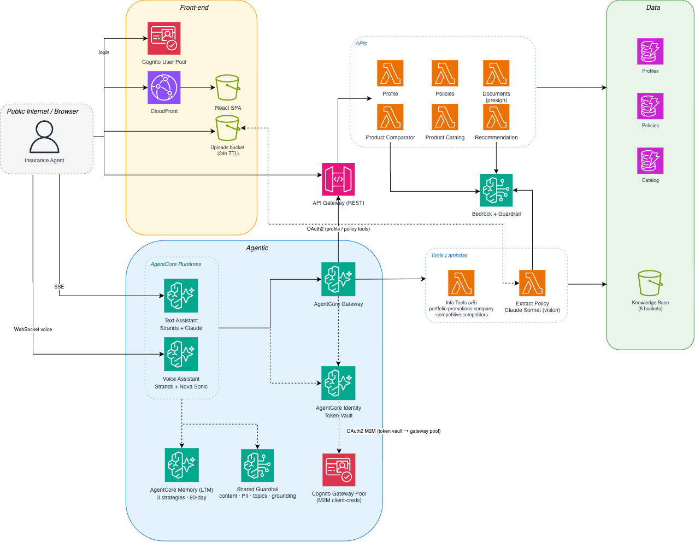

# Frictionless Insurance Advisor

**Frictionless Insurance Advisor** is an AI co-pilot for insurance advisors at the fictional Awesome Insurance, built end-to-end on Amazon Bedrock AgentCore.

> An AI co-pilot that gives every advisor instant, coverage-aware insight into each customer's portfolio, products, and competitors — so they walk into every conversation already prepared.

> **Sample code, not production software.** Awesome Insurance, its products, the competitors (BigRival, Brookmere, QuickSafe, Corvane Assurance), the customers and every document in `s3-data/` are fictional and exist only for this demonstration; any resemblance to a real company or person is coincidental. Nothing the assistants say is insurance, legal, tax or investment advice. Read [Security posture](#security-posture) and [Limitations](#limitations) before adapting any of it. Deploying creates billable AWS resources (Amazon Bedrock, Bedrock AgentCore, Lambda, API Gateway, CloudFront, DynamoDB, S3 and others): run `./destroy.sh` when you are done, and see [Teardown](#teardown).

Advisors sign in to a React app and either chat with the agent or talk to it in real time. The agent reaches across twenty MCP tools on the AgentCore Gateway: customer profiles and notes, policies, the Awesome product catalog, current promotions, company facts, competitive talking points, competitor product references, policy-document extraction, application-form schemas, pricing tables, indicative premium estimates, savings-gap calculators, the advisor's priorities for the day and a web search for general insurance questions. It answers from real customer data and cites the documents or web pages it used. It tracks the third-party policies a customer holds elsewhere so cross-sell suggestions stay coverage-aware, can onboard a brand-new prospect just by talking, reads uploaded policy documents (PDF / image / markdown) into structured fields the advisor confirms before saving, and remembers context per customer across sessions through AgentCore Memory.

On top of chat, the advisor gets a one-click meeting-prep brief, application forms for ten Awesome products that the text or voice assistant fills in from the conversation (with a printable PDF), indicative premium estimates with an affordability check, and customer notes that the assistant can add when asked. Separate comparator and recommender Lambdas generate side-by-side product views (with carrier financial-strength ratings, a customer handout PDF and an optional uploaded competitor brochure) and structured coverage-gap analyses with a dollar exposure per gap. A built-in data explorer lets the advisor read the same reference documents the agent is grounded in, and the advisor's own voice transcripts, which are kept for 24 hours and only after the customer's recording consent is confirmed.

The app is available in **nine languages**, and every surface — chat, voice, comparator, recommender, and the UI itself — responds in the advisor's chosen locale.

## Why it matters

| For the advisor | For the customer | For the business |
|---|---|---|
| No more portal-flipping. Profile, gaps, promos, and competitive answers ready the moment a customer is selected. Drag a competitor PDF in and the policy is on file in seconds. | Faster, more personal meetings. Advice grounded in actual coverage. Confident answers about competitors. | Shorter prep time. Higher-quality cross-sell. Faster new-advisor ramp. PII, compliance and "estimates, never binding quotes" boundaries baked in. |

## Models

| Surface | Model | Why |
|---|---|---|
| Conversational text agent | Anthropic **Claude Haiku 5.5** | Fast, low-cost multi-turn reasoning with tool use |
| Voice agent | Amazon **Nova 2.5 Sonic** | Bidirectional voice with low end-to-end latency |
| Comparator + recommender Lambdas | Anthropic **Claude Haiku 5.5** | Structured output through a forced tool call |
| Policy-document extraction, competitor-brochure reading | Anthropic **Claude Haiku 5.5** | Reads PDFs and images directly and fills a fixed schema |

All Claude calls use the `us.anthropic.claude-haiku-5-5` cross-region inference profile (one constant, `TEXT_MODEL_ID`, in `cdk/tools_stack.py`; the agent has its own in `agent/app.py`). Two things about this model matter when changing code:

- **It rejects `temperature`.** The Lambdas send no sampling parameters; a forced tool choice is what keeps the output on its schema.
- **It thinks by default.** The text agent turns thinking off and sets an explicit output limit (12,000 tokens). Without that, long answers such as a meeting brief stopped at the default limit with no text.

AgentCore Memory runs its own service-managed extraction models; they are not configured in this repo.

## Architecture



> Rendered from the `architecture.drawio` source.

```
       React + Vite SPA                                Cognito user pool
       (CloudFront-hosted, or `npm run dev` locally)   (advisors)
                │
                │  Cognito JWT (Bearer)
                │
                ├─────────────────────────────────────────────────────┐
                │                                                     │
                ▼                                                     ▼
   AgentCore Runtime (text)                              API Gateway + WAF
   AgentCore Runtime (voice)                             (profile, policy,
   container · ARM64                                     catalog, comparator,
   Strands · Haiku 5.5 / Nova 2.5 Sonic                      recommend, signup,
                │                                        documents, data)
                │  M2M JWT via AgentCore Identity Token Vault
                │  + the advisor's own Cognito token (X-Advisor-Token)
                ▼
   AgentCore Gateway (MCP, 12 targets · 20 tools)
   request interceptor λ: verifies the advisor's token before every tool call
                │
                ├── advisor's token → API Gateway → λ profile (incl. notes), λ policies, λ priorities → DynamoDB
                ├── IAM    → λ portfolio · promotions · company · competitive · competitors → S3
                ├── IAM    → λ formschema · pricing table · premium estimate → S3 (+ DynamoDB for affordability)
                ├── IAM    → λ extract_policy → S3 (uploaded docs) → Bedrock (Claude Haiku 5.5)
                └── IAM    → AgentCore web-search connector (text agent only)
                ▲
                │  + AgentCore Memory (summaries · preferences · facts)
                │  + Bedrock Guardrail (content + topics + grounding + PII)
                │  + voice transcripts → private S3 bucket (24 h, after consent)
```

## CDK stacks

Five stacks, deployed in order:

| Stack | Purpose |
|---|---|
| `insadv-01-auth` | Cognito user pool (advisors) + gateway pool (M2M) + app + runtime + gateway clients |
| `insadv-02-tools` | DynamoDB profiles + policies + catalog tables; 23 Lambdas (profile, policies, portfolio, promotions, company, competitive, competitors, catalog, comparator, comparator_ingest, recommend, signup, documents, extract_policy, formschema, pricing table, pricing estimate, data, mock_data, priorities, meeting_summary, calculators, roleplay_score); API Gateway with WAF (rate-limited /signup); private S3 buckets for the knowledge bases (portfolio, company, competitive, competitors, promotions), application forms, pricing tables, PDF brochures, uploaded documents (1-day expiry) and voice transcripts (1-day expiry); **shared Bedrock Guardrail** consumed by every model surface; AWS Budget on Bedrock, Bedrock AgentCore and Lambda spend; KMS key for log encryption |
| `insadv-03-agentcore` | AgentCore Runtime (Claude Haiku 5.5 text agent), Gateway with twelve targets (twenty tools, including the web-search connector), AgentCore Identity OAuth2 credential providers, long-term memory (summary + preference + semantic strategies, 90-day TTL) |
| `insadv-04-voice` | AgentCore Runtime (Nova 2.5 Sonic voice agent), shares the same gateway, memory and Cognito as the text runtime. Built on the stable `strands.bidi` API with pinned dependencies (`voice-agent/requirements.txt`, full set in `constraints.txt`) and OpenTelemetry traces with the conversation content redacted |
| `insadv-05-frontend` | S3 site bucket + CloudFront distribution with Origin Access Control hosting the React build |

`deploy.sh` handles the ordering: backend stacks first (parallel where the DAG allows via `--concurrency 4`), then `npm run build` against fresh SSM env vars, then the frontend stack. The frontend stack only synthesises after `react-frontend/dist/` exists, so a cold `cdk deploy insadv-01-auth` still works on a clean checkout.

Both AgentCore runtimes are plain `AWS::BedrockAgentCore::Runtime` (L1 `CfnRuntime`). They previously went through an `AwsCustomResource` wrapper plus a post-deploy script, because `requestHeaderConfiguration` was not exposed by CloudFormation and the provider Lambda's deploy-time SDK silently dropped the field — leaving `Authorization` not forwarded into the container. It is now a first-class CloudFormation property, so the allowlist is declared in the stack and no post-deploy reconciliation is needed.

## Agent tools (MCP)

Twenty tools on twelve gateway targets (the profile, policy and priorities tools share one OpenAPI target). Awesome reference data is read-only. The agent can write only three kinds of records: prospect onboarding, third-party policy tracking, and customer notes, each after the advisor asks or confirms.

| Tool | Source | Purpose |
|---|---|---|
| `get_profile` / `create_profile` / `update_profile` | Profile Lambda → DynamoDB | Customer profile read + prospect onboarding |
| `add_note` | Profile Lambda → DynamoDB | Saves a life-event or interaction note on a customer (source `assistant`). Only when the advisor's own message asks for a note or says yes right after the assistant offers one; a code guard in the agent cancels the call otherwise. There is no delete tool |
| `get_policy` / `create_third_party_policy` / `update_third_party_policy` / `delete_third_party_policy` | Policies Lambda → DynamoDB | Customer policy read + third-party policy CRUD (Awesome-issued policies stay read-only). Every policy carries `annual_premium` and `days_until_renewal`; with `include_totals=true` the answer is `{policies, totals}` (yearly totals for Awesome and other insurers, renewals in date order, share of income against the 10% guide), all computed in code |
| `get_priorities` | Priorities Lambda → DynamoDB | The advisor's ranked to-do list: review overdue, life event coming up or just passed, renewal due or missed, premiums over the 10% guide, prospect gone quiet. Rules and scores are computed in code; no model is involved |
| `get_portfolio` | Portfolio Lambda → S3 | Awesome product catalog, including a "unique features" paragraph per product |
| `get_promotions` | Promotions Lambda → S3 | Current promotions |
| `get_company_info` | Company Lambda → S3 | Awesome: history, credentials and carrier ratings, claims, support |
| `get_competitive_info` | Competitive Lambda → S3 | Awesome's competitive talking points and head-to-head Q&A |
| `get_competitor_products` | Competitors Lambda → S3 | Reference info on fictional competitors BigRival, Brookmere, QuickSafe |
| `extract_policy_from_document` | Extract Policy Lambda → S3 + Bedrock | Reads an uploaded PDF/image/markdown and returns structured policy fields with defense-in-depth validators (numeric clamps, date sanity, injection-keyword heuristic, insurer rejection) |
| `get_form_schema` | Form Schema Lambda → S3 | Application-form schema for any of the ten Awesome products (sections, fields, types, required flags). `product_type` is checked against an allowlist before it becomes an S3 key; unknown values return the published list so the agent can self-correct |
| `get_pricing_table` | Pricing Lambda → S3 | The indicative rate file for a product type, or the list of priced products and what each needs |
| `estimate_premium` | Pricing Lambda → S3 + DynamoDB | One priced configuration, computed in code, with the customer's age and gender taken from their record and a check of total yearly premiums against 10% of income |
| `calculate_savings_gap` | Calculators Lambda | Education and retirement savings-gap scenarios. All compound-growth maths runs in code; every answer lists its assumptions (defaults in `lambda/calculators/assumptions.json`, overridable per call) and carries an illustration disclaimer |
| `WebSearch` | AgentCore web-search connector | General insurance questions the Awesome documents do not cover. **Text agent only**: the voice agent drops this tool at start-up. Social-media and forum domains are excluded |

The text and voice agents also have two local tools, `open_application_form` and `fill_form_field` (see Application forms), and the voice agent has `record_consent`. They need the browser connection in scope, so they cannot be gateway tools.

The comparator (side-by-side product table), the competitor-brochure reader and the recommender (coverage-gap analysis) are direct Bedrock Converse calls from their own Lambdas behind the API Gateway, not MCP tools. They are one-shot structured generations that do not benefit from the runtime's tool-use loop.

### Sources on every answer

When an answer uses Awesome documents or web results, the text assistant ends with a **Sources** footer. It is built in code (`agent/sources.py`), not by the model: the footer lists only what the turn's tools actually returned **and** that the answer names by path or URL, so the model cannot add a link of its own. Document chips open Data Explorer on that file in a new browser tab (the chat lives inside the Assistant page and would be lost by switching tabs); web chips open the page. Premium and rate answers cite the rate file.

Web search is the last resort: customer data first, Awesome documents second, the web only for general questions. It is never used for Awesome products, prices, ratings, promotions, forms or customers, nor to price or describe a named competitor product (even if asked), and queries carry no customer details.

## Frontend surfaces

Four tabs in the React app, each lazy-loaded:

| Tab | Backed by | What the advisor does |
|---|---|---|
| **Text Assistant** | AgentCore text runtime (SSE) | Streaming chat with a Sources footer, per-customer history, document upload, "New Prospect" onboarding, a one-click **meeting-prep** quick prompt, pricing estimates with a rate card, and application forms that open beside the chat and fill from the conversation |
| **Text+Voice Assistant** | AgentCore voice runtime (WebSocket) | Real-time voice with barge-in, a recording-consent bar, and a self-filling application form |
| **Comparator** | Comparator + recommender Lambdas | Side-by-side view of 2-4 products with carrier financial-strength ratings, a customer handout PDF, an optional uploaded competitor brochure (or one of ten samples); per-customer coverage-gap analysis with dollar exposure |
| **Data Explorer** | `data` Lambda → S3 | Browse and read the reference documents the agent is grounded in, rate cards, PDF brochures, and the advisor's own voice transcripts |

The customer sidebar (profile, policies, and a **Notes** card for life events and interactions), dark-mode toggle, language switcher, and a pitch-deck link are shared across tabs. Panel sizes and sidebar state persist to `localStorage`.

**Cockpit (today's priorities).** With no customer selected, the welcome area lists the customers who most need attention, most urgent first, each with the reason and a one-click action that opens the customer and starts that prompt: **Draft email** when the strongest reason is a date to reach out about (a life event, a renewal, a quiet prospect), **Annual review** when the file needs attention (a stale review, premiums over the 10% guide, or a renewal on a file that is also due for review), and **Prepare meeting** for a prospect with no Awesome cover. The button reloads the list from the service; nothing is stored. The ranking comes from `lambda/priorities` (`GET /priorities`); the assistants answer "what should I do today?" from the same list through `get_priorities`.

**Annual review, outreach drafts, meeting notes, options, market pulse, savings goals.** Prompt-level features of the text assistant: an annual-review pack (policies table with renewals, notes since the last review, ranked gaps, affordability from the service's totals, next steps), two drafted messages (warmer and more direct; the app never sends anything), a Summary / Concerns / Next actions note from a recap (saved only after the advisor says yes), up to three priced options via `estimate_premium`, an on-demand market digest from web search, and education / retirement savings-gap answers from `calculate_savings_gap`. Anything that projects or illustrates ends with an "illustration, not a quote or a promise" line.

**Meeting note from a voice session.** On the Text+Voice tab, once recording consent is confirmed and something has been said, **Summarise into a note** sends the conversation to `POST /meeting-summary` (`lambda/meeting_summary`, forced tool call, shared guardrail). The advisor gets an editable Summary / Concerns / Next actions draft (at most 1,000 characters) and presses Save, which uses the ordinary notes route as the advisor. The assistant never writes this note, and the conversation text is neither stored nor logged by the Lambda.

**Practice mode (role-play).** **Practise** on the Text+Voice tab starts a session in which the voice assistant plays the selected customer (difficulty and main objection chosen by the advisor), using facts from the record on screen: name, age, family, work, income, notes and policies, never health details. A practice session has no consent step, is never recorded, reads and writes no memory, and the AI has no tools except the one that ends the session. **End and score** sends the turns to `POST /roleplay-score` (`lambda/roleplay_score`), which returns 0-5 scores on seven criteria with a quote and a suggestion each, a check of the advisor's product statements against the product sheets, and three things to try next time; the overall score is computed in code. Nothing is stored, and it is coaching feedback, not a performance rating. Voice has no guardrail (see Bedrock Guardrail), so the persona prompt limits the AI to the facts it was given.

**Meeting prep.** The quick prompt "Help me prepare for my meeting with this customer" returns a fixed-structure brief: customer snapshot, meeting goals, discovery questions, products to discuss, objection handling (as a table) and a close with next step. It draws on the customer's notes, third-party policies, promotions and competitor material, and ends with its sources.

**Customer notes.** Notes are typed (`life_event` or `interaction`), up to 1,000 characters, at most 100 per profile. The advisor adds and deletes them in the Notes card; the assistant can add one (labelled "Added by assistant") but never delete. The API route for adding accepts both the sign-in and the gateway token; the delete route accepts only the sign-in token.

### Data explorer

The Data Explorer tab is a read-only window onto the same `s3-data` corpus the agent reads, so an advisor can check the underlying source rather than taking a generated answer on faith. It also shows the advisor's own voice transcripts, scoped to the signed-in advisor.

Nine folders are surfaced: Product Portfolio, Company Info, Competitive Positioning, Competitor Products, Promotions, Application Forms, Pricing Tables, Brochures, and Voice transcripts. The first eight are allowlisted and ordered server-side in the `data` Lambda; `mock-policies` is deliberately excluded because those are served as static downloads instead. Text folders show only `.md` and `.json`.

- The file listing is fetched once (metadata only); document bodies load lazily per selection and are cached for the session.
- Markdown renders at full document type scale, with front matter stripped and shown as a "Last updated" line.
- **Form-schema JSON gets a real rendered view** (section cards listing each field's label, type, required flag, dotted path, hint, and options) with a Rendered/Raw toggle for the source.
- **Carrier ratings get a table**: `competitors/carrier_ratings.json` shows one row per carrier and one column per agency (AM Best, S&P, Moody's) with rating, label and outlook, an "Illustrative" tag on the fictitious competitors, and the as-of date. It is the file the Comparator's ratings row reads.
- **The folder list folds.** Each folder in the left column has a chevron to collapse or expand it, and a Collapse all / Expand all link sits next to the file count. The choice is remembered in the browser. A search shows every match regardless, and opening a document from a link reopens its folder.
- **Pricing tables get a rendered rate card**: age bands, rates per unit of cover, factors, add-ons, what the price depends on, and an "Indicative only" label.
- **Brochures** are ten one-page Awesome PDFs with no prices, shown in an in-page viewer with Open and Download. They are served through 2-minute presigned S3 links, so no binary passes through API Gateway. No agent role can read the brochures bucket.
- **Voice transcripts** list the advisor's sessions newest first (date and time, customer or Prospect, turn count, "in progress" while open) and open in a chat-style view with times, a "typed" marker, the customer for each stretch, and a banner with the expiry rule and consent time. Refresh reloads a live session; Raw shows the JSON.
- Search filters across filename, sub-path, and folder label.
- `competitive` and `competitors` documents carry an **Internal Use Only** badge so a battlecard doesn't get screen-shared to a customer.

Content reaches the browser through API Gateway and the `data` Lambda, authorized with the same Cognito JWT as every other API route. Nothing is bundled into the SPA and the browser never touches S3 directly, so the knowledge-base buckets stay private.

## Application forms (text and voice)

When the advisor and customer agree to start an application, an application form opens beside the chat (text assistant) or takes over the left panel (voice assistant) and fills itself from the conversation and the customer's record. Both agents fill forms the same way. In voice the advisor keeps talking and fields land as they speak.

**Ten Awesome products** have published forms, each backed by a JSON schema in S3 (`s3-data/forms/`). Files are named after the product's portfolio file, `<product>-form.json` (for example `awesome-disability-form.json`); the product type (`term_life`, `disability`, ...) stays the identifier the tools use, and each service holds the type-to-file map that doubles as the S3 key allowlist:

| `product_type` | Product |
|---|---|
| `term_life` | Awesome Term Life |
| `whole_life` | Awesome Whole Life |
| `universal_life` | Awesome Universal Life |
| `variable_life` | Awesome Variable Life |
| `critical_illness` | Awesome Critical Illness |
| `health` | Awesome Health |
| `home` | Awesome Home Insurance |
| `auto` | Awesome Motor |
| `travel` | Awesome Travel |
| `disability` | Awesome Disability |

**Answers carry over when the product changes.** Field state is keyed on the dotted path and deliberately not cleared when the product changes. All ten forms share seven applicant fields (name, date of birth, address, phone, email, occupation, income), and the four life forms share 18 of about 20 paths, so moving from term to whole life leaves only the product-specific fields outstanding. The tool tells the agent exactly what carried over so it does not re-ask. The forms hold no SSN, bank, card or licence-number fields.

**Tools, split by concern:**

| Tool | Where | Why |
|---|---|---|
| `get_form_schema` | Gateway target (shared) | Read-only data lookup. Answers "what does this application require?" without opening anything on screen |
| `open_application_form` | Local to each runtime | Reads the schema straight from S3 and sends it to the browser. Needs the connection in scope, so it cannot be a gateway tool |
| `fill_form_field` | Local to each runtime | Emits one field to the browser |

The schema is **never routed through the model**. `open_application_form` fetches from S3 server-side and sends it to the browser directly; the model only gets back a compact list of field paths and what is already known, worded as a plain description (instruction-style wording in a tool result tripped the guardrail's prompt-attack filter). Passing 20 fields of JSON back out as a tool argument would burn tokens twice and risk silent truncation or invented fields.

**Confidence drives the UI, not the data.** The model self-reports 0.0-1.0 per field. At 0.85 or more a field fills green; below that it fills amber with a "Looks right" confirm. Nothing is hidden from the advisor. These scores are a heuristic prompt signal, **not calibrated probabilities**. Values are clamped server-side and default to amber if malformed.

**Guards.** `fill_form_field` rejects any path not in the schema actually opened, and refuses outright if no form is open, because field paths originate from a model and the UI keys its state on them. `product_type` is allowlisted before it becomes an S3 key. In voice, form filling is also blocked until recording consent is confirmed.

Precedence is **manual > conversation > profile**: fields known from the customer's record are prefilled and marked as such, the conversation can override them (a job change, say), and anything the advisor types by hand is never overwritten.

**Download PDF** produces a printable application with the answers so far, unanswered lines left blank and a signature line for the applicant. "Send for Signature" is a demo button; nothing is sent. The PDF libraries are loaded only when the button is used.

## Pricing and affordability

`get_pricing_table` and `estimate_premium` give the assistants indicative premiums for all ten products from rate files in S3 (`s3-data/pricing/<product>-pricing.json`, for example `awesome-term-life-pricing.json`, built by `tools/pricing/build_rates.py`). Each rate file describes its own inputs, tables and factors, so adding a product means adding a file.

- **All arithmetic runs in the Lambda.** The model chooses the inputs and reads the result back; it never multiplies a rate itself. Option values are validated against the rate file's definitions.
- **Age and gender come from the customer's record** (gender is now a profile field), so the assistant does not ask for what it already knows.
- **Gender x age band.** Every product with an age-banded base table (the four life products, Critical Illness, Health and Disability) takes a gender input. The table value is the male reference; a female applicant gets a multiplier for her age band (a `when: {gender: female}` band factor in the rate file, shown in Data Explorer's rate card). The Health, Critical Illness and Disability multipliers are illustrative placeholders until the pricing factors are confirmed. Travel is priced by geography and trip length, Motor and Home by their own factors; none of them take gender.
- **Affordability.** When the customer is known, the total of all active yearly premiums, other insurers' included, plus the proposed one is compared with 10% of income. Missing income returns `income_unknown`.
- **Always an estimate.** Results and answers are labelled indicative; they are not quotes and nothing binds coverage. Premium answers cite the rate file.
- **Illustrations carry a closing line.** Both assistants end an answer that contains a projection, a what-if or a worked example with a short "illustration, not a quote or a promise" line (in the text assistant, above the Sources footer). Plain factual answers and premium estimates, which have their own disclaimer, do not get it.

## Voice runtime internals

The voice agent uses the stable `strands.bidi` API (`BidiAgent` and `BedrockNovaSonicModel`, `strands-agents` 1.59). The packages are pinned in `voice-agent/requirements.txt` because the library's bidi interface has changed between releases (events, class names, how a conversation is stopped). To upgrade, bump the pins and re-run the voice checks.
- **Model.** `amazon.nova-2-5-sonic` (Nova 2.5 Sonic), set once as `MODEL_ID` in `cdk/voice_stack.py`, which feeds both the runtime's environment and its IAM policy. It has the same API surface, voices and languages as Nova 2 Sonic (`amazon.nova-2-sonic-v1:0`), and runs on demand in us-east-1 (no inference profile). In a side-by-side run of the same tool-calling question (5 trials each) it called the tool in 0.66 s against 0.81 s and began speaking after 1.27 s against 1.62 s, with the correct tool argument and the correct figure in the answer every time.

- **Browser protocol is ours.** The browser sends `bidi_audio_input` / `bidi_text_input` / `voice_*` messages and receives `bidi_audio_stream`, `bidi_transcript_stream`, `bidi_interruption`, `consent` and form messages. `voice-agent/wire.py` is the only place that translates to and from the library's events, so a library change does not reach the frontend.
- **Stopping.** "Stop conversation" is a local tool that calls `agent.cancel()`, the library's way to end a session after the current tool call.
- **Connection limits.** Nova Sonic caps one connection at about 8 minutes, so the library restarts it proactively at 7 minutes and replays the conversation. A 12-minute session with questions before and after the restart kept its context. Re-checked on Nova 2.5 Sonic with the restart interval shortened to 25 seconds: the conversation context and a tool call both survived the restart. Separately, Nova Sonic ends a session after about 5 minutes with no speech and no typed message (silent audio frames do not count), the same as before the migration.

## Recording consent and voice transcripts

The voice assistant asks, when the advisor first starts the microphone, "Before we start, can you confirm {customer} has agreed to this conversation being transcribed?" The advisor answers aloud (the `record_consent` tool) or with the Confirmed / Declined buttons in the bar above the chat. Consent is per session and per customer.

- **Until confirmed, three things are blocked in code:** memory writes (a session manager that refuses to create events), form filling, and transcript storage.
- **Declined** ends the session, clears the on-screen conversation and writes nothing.
- **Switching customer** resets consent and the question is asked again, because a different person is being discussed. A prospect has no profile to hold a note, so a prospect's consent is recorded only in the transcript header.
- **Transcripts** are saved as `<advisor>/<start>-<session>.json` to a private bucket about every 30 seconds while there are new turns, and once more on close. Objects expire after one day (they disappear 24 to 48 hours after the last write). The voice runtime can only `PutObject`; the `data` Lambda can only read, and only the signed-in advisor's prefix, identified from the verified token; no agent tool has access. Transcript text is not written to logs.
- The advisor reads them in the Data Explorer tab ("Voice transcripts").

## Bedrock Guardrail

A single shared guardrail (`insurance-advisor-guardrail-shared`) lives in `insadv-02-tools` and gates the five Claude surfaces: the text agent, the comparator Lambda, the brochure reader, the recommender Lambda and the extract_policy Lambda. The same policy, applied five ways. **The voice agent is not covered**: the Nova Sonic bidirectional stream has no guardrail setting (the guardrail keys that earlier versions of this code passed to the model were ignored by the library), so voice relies on its system prompt and the tool-level checks. The published version is written to SSM (`/insadv/bedrock/guardrail-version`) on every policy change so all callers pick up updates on cold start without a runtime redeploy.

| Policy | Configuration |
|---|---|
| Content filters | `SEXUAL`, `VIOLENCE`, `HATE`, `INSULTS` at HIGH input + HIGH output. `MISCONDUCT` at **LOW** input + LOW output (see below). `PROMPT_ATTACK` at HIGH input only. |
| PII anonymized | `US_SOCIAL_SECURITY_NUMBER`, `CREDIT_DEBIT_CARD_NUMBER`, `US_BANK_ACCOUNT_NUMBER`, `CREDIT_DEBIT_CARD_CVV`, `CREDIT_DEBIT_CARD_EXPIRY`, `PIN`, `INTERNATIONAL_BANK_ACCOUNT_NUMBER`, `SWIFT_CODE`, `US_PASSPORT_NUMBER`, `DRIVER_ID`, `US_INDIVIDUAL_TAX_IDENTIFICATION_NUMBER`. |
| PII blocked (whole request refused) | `PASSWORD`, `AWS_ACCESS_KEY`, `AWS_SECRET_KEY`. |
| PII not anonymized — by design | `NAME`, `EMAIL`, `PHONE`, `ADDRESS`, `AGE`, `DATE_OF_BIRTH`. These are integral to legitimate advisor workflows; output-side log redaction is the right place for those. |
| Word policy | AWS-managed `PROFANITY` list. |
| Denied topics | `LegalAdvice`, `InvestmentRecommendations` (asset-allocation / sub-account picks) and `TaxAdvice`. All `DENY`. |
| Contextual grounding | `GROUNDING` ≥ 0.75, `RELEVANCE` ≥ 0.5. Active on the comparator + recommender Lambdas (which tag their source markdown / customer profile / catalog as `grounding_source`) and the uploaded-brochure comparison; attached but inert on the text runtime (Strands tool results aren't tagged as sources). |

Interventions surface as a clean 400 (or, in chat, the configured `blocked_outputs_messaging`).

**Two deliberate relaxations, both for the demo.** The `UnderwritingDecisions` denied topic was removed because it blocked routine product questions such as "what are the eligibility rules?". The `MISCONDUCT` filter is at LOW because at HIGH it blocked harmless lead-in sentences in the text assistant's form flow ("I'll pull the profile and open the application to pre-fill what we know"): the form opened 4 of 6 times and filled 0 of 6 at HIGH, against 6 of 6 and 5 to 6 fields each at LOW. Clearly harmful requests (forged signatures, concealing a medical condition, a fabricated medical report) and prompt-extraction attempts are still refused. Not promising approvals, rate classes or claim payouts is now enforced by the system prompts rather than a guardrail topic. A production build should revisit both.

## Security posture

Security was a first-class design constraint. A number of hardening items are deliberately deferred for production (Cognito MFA, Macie PII detection, a business-event audit log, etc.).

Highlights of what's enforced today:

- **Advisor identity is JWT-only.** The runtime resolves the calling advisor exclusively from the verified Cognito JWT (forwarded via `requestHeaderConfiguration`). Voice WebSocket closes with 1008 if no validated identity is available.
- **The advisor is whoever the signed-in token says, checked on the server.** The runtimes reach the gateway with a machine token, which proves "this is our runtime" and nothing about which advisor is being served. So they also send the advisor's own access token, and a gateway request interceptor (`lambda/gateway_interceptor`) checks it with Cognito before every tool call: it must be genuine, unexpired, not signed out, and issued by this user pool to this app client. With no valid advisor token no tool runs, so the machine token alone gets nothing. The interceptor then runs the call as that advisor. The REST tools no longer take an `advisor_id` at all: the advisor's token replaces the machine token on the call to the API, and the Lambdas read the advisor only from the API authorizer's verified claims, never from the query string or body. For the two Lambda tools that still take one (`estimate_premium`, `extract_policy_from_document`), the interceptor overwrites it with the verified advisor's email. Text hidden in a note, an uploaded policy or a brochure therefore cannot steer a call to another advisor's data, and neither can anyone who obtains the machine credentials. `agent/identity_guard.py` (a copy in `voice-agent/`) is a second layer inside the runtime.
- **The API accepts no machine token.** Every route requires the sign-in scope (`aws.cognito.signin.user.admin`). The `insurance-advisor-api/api.access` machine scope is accepted nowhere, so a token minted from the gateway client's credentials gets a 401 from API Gateway.
- **Cross-tenant isolation** at the Lambda layer: `advisor-id-index` GSI is a key condition (not a filter) on every read, plus an explicit `advisor_id == calling_user` check on every mutation.
- **The user pool is closed.** Self sign-up is switched off in the template itself (`AllowAdminCreateUserOnly`), so it holds whatever your account's policies are. There is no unauthenticated API route by default: the three demo advisors are created once, by you, with `scripts/create-demo-users.sh` (generated password, shown once). An opt-in public `/signup` route exists for people who want it (see Limitations).
- **Cost-bomb defense.** AWS Budget with 50/80/100% SNS notifications, filtered on four billing services: Amazon Bedrock, Amazon Bedrock Service (where Claude token usage is billed), Amazon Bedrock AgentCore and AWS Lambda. The filter is by service, not by project, so it counts the whole account's usage of them. API Gateway throttling on `/comparator/compare` and `/recommend` (5 rps steady, 10 burst).
- **Notes record who wrote them.** A note added through the assistant is labelled as the assistant's (the interceptor adds a marker header that the Lambda reads), and one typed in the app is labelled as the advisor's. Deleting a note is refused for any call that carries the marker, and no gateway tool exists for delete. The agent also cancels an `add_note` call unless the advisor's own message asked for it.
- **Private buckets for sensitive material.** The brochures bucket is not readable by any agent role. The transcripts bucket takes `PutObject` from the voice runtime only and is read only by the `data` Lambda, for the signed-in advisor's own prefix; both uploaded documents and transcripts expire after one day. The `data` Lambda resolves the caller from the verified token and treats everything outside that prefix as not found.
- **Uploaded competitor brochures** are validated (type, size, the selected product type, not an Awesome product, not a customer's policy), read with a forced tool call under the guardrail, stored under the uploading advisor's own prefix for a day, and compared by a `temp_id` the Lambda checks against the caller. The browser never sends brochure content back.
- **Document extraction safety net.** `extract_policy_from_document` clamps coverage and premium amounts to sane ranges, rejects non-current dates, refuses "Awesome" as the third-party insurer, and forces low extraction confidence on injection-keyword matches; the agent's system prompt then switches to field-by-field confirmation before any write. The model request carries no `temperature`, which the current model rejects.
- **Log retention bounded.** All tools-stack Lambda log groups now have ONE_MONTH retention; the API Gateway access log group is encrypted with a customer-managed KMS key with rotation enabled.
- **Reproducible, audited dependencies.** Both container images pin their direct dependencies (`agent/requirements.txt`, `voice-agent/requirements.txt`), the CDK project and the frontend are locked (`uv.lock`, `package-lock.json`), and the container base images are pinned by digest.
- **Quiet logs by default.** The text agent logs at INFO. At DEBUG the libraries write whole model requests (system prompt, customer profile, tool results) to CloudWatch, so `AGENT_LOG_LEVEL=DEBUG` (CDK context `agent_log_level`) is for troubleshooting with fictional data only.
- **Voice traces without conversation content.** The voice runtime starts under OpenTelemetry auto-instrumentation, so AgentCore Observability shows session, model-response and tool-call spans with timings, tool names and token counts. By default those spans would also carry the customer's name, the system prompt and tool results. `OTEL_SEMCONV_STABILITY_OPT_IN=gen_ai_unredacted_attributes=` (set in `cdk/voice_stack.py`) replaces that content with `[REDACTED]`, and `OTEL_PYTHON_DISABLED_INSTRUMENTATIONS=aws_mcp` drops the distro's MCP call spans, which copy each tool result. Leave both set.
- **Browser hardening.** CloudFront adds HSTS, `X-Content-Type-Options`, `X-Frame-Options`, a referrer policy and XSS-protection headers (the managed security-headers policy); the model-calling API routes are throttled.
- **AgentCore Memory TTL** capped at 90 days (down from the 365-day platform default) to bound the GDPR right-to-erasure window.

## Quick start

### Prerequisites

- AWS account + credentials in your shell, region `us-east-1`
- Python 3.13, [`uv`](https://docs.astral.sh/uv/)
- Node.js 18+
- A container builder running (Finch is supported; Docker / Colima also work)
- Nothing to install for the CDK CLI: `deploy.sh` and `destroy.sh` run the pinned version (`aws-cdk@2.1144.0`, the `CDK_CLI_VERSION` variable) through `npx`, matched to `aws-cdk-lib==2.272.0` in `pyproject.toml`. Bump the two together.
- Bedrock model access in `us-east-1` for Claude Haiku 5.5 and Nova 2.5 Sonic

### Deploy

```bash
./deploy.sh
```

Runs `uv sync`, deploys backend stacks (`insadv-01-auth` → `04-voice` with `--concurrency 4`), generates the sample-policy PDFs, pulls SSM values into `react-frontend/.env.local` via `setup-env.sh`, runs `npm install && npm run build`, then deploys `insadv-05-frontend`. First deploy ~10 minutes (Cognito pools, WAF, agent + voice container builds, AgentCore runtime + memory provisioning). Subsequent redeploys are incremental.

The frontend must be rebuilt whenever the runtime ARNs change, because `setup-env.sh` bakes them into the bundle at build time. `deploy.sh` already does this in the right order — prefer a full run over a partial `cdk deploy` of a single stack.

The CloudFront URL is emitted as `insadv-05-frontend.SiteUrl`.

### Run locally instead

```bash
cd react-frontend
./run_app.sh
```

Opens at http://localhost:5173. First run auto-populates `.env.local` from SSM via `scripts/setup-env.sh`. The browser only ever holds a Cognito JWT — no AWS IAM credentials.

### Sign in

The user pool is closed, so after your **first** deploy create the three demo advisors once with `./scripts/create-demo-users.sh`. It prints a generated password for each **once** (copy it then; nothing stores it). `deploy.sh` does not run it, and you do not need to run it again on later deploys. The script skips users that already exist and never resets a password; delete the user in the Cognito console first if you need a new one. Set `DEMO_USER_PASSWORD` to choose your own password instead of a generated one.
Sign in as one of them to see seeded customers:
- `john.doe@example.com` (**all lines**: life, general and health products) → customers Marcus, Hannah, Carlos, Olivia, Ethan and prospects Sophie, Tom
- `life@example.com` (the **Life** advisor: life and health products only) → customers Sarah, Emily, Robert, Amanda, David and prospect Nadia
- `general@example.com` (the **General / P&C** advisor: motor, home, travel and health products only) → customers Lisa, Michael, Jessica, Priya and prospects Daniel, Leo
A prospect is a customer with no active Awesome policy (some hold a competitor's policy). Olivia (no life cover) and Ethan (a life policy far below his income) are there to show a life gap in the gap analysis.
Passwords need 12+ characters with upper, lower, digit and symbol. There is no "Create account" tab in a default deployment.

### Sales pitch deck

In the running app, click the slideshow icon top-right of the nav. The Frictionless Insurance Advisor pitch deck opens at `/presentation/index.html`. Source files live in `react-frontend/public/presentation/`.

## Authentication and identity

Two channels, same Cognito JWT.

**1. Browser → AgentCore Runtime** (text + voice)
- React signs in via Amplify against the `insurance-advisor-user` Cognito pool.
- Text: HTTPS POST to `bedrock-agentcore.<region>.amazonaws.com/runtimes/{ARN}/invocations` with `Authorization: Bearer <jwt>`. Streams SSE. The runtime forwards the Authorization header into the container via `requestHeaderConfiguration` and verifies the JWT in-process.
- Voice: WebSocket to the same host's `/ws` path. Browsers can't set headers on a WebSocket, so the JWT travels base64url-encoded as a `Sec-WebSocket-Protocol` subprotocol — AgentCore's documented browser-OAuth path. The Authorization header is also forwarded for consistency with the text path.

**2. Browser → API Gateway** (profile and notes, policy, catalog, comparator and brochure ingest, recommender, signup, documents, data)
- Same JWT, this time validated by an API Gateway `CognitoUserPoolsAuthorizer` against the user pool. Methods require the sign-in scope (`aws.cognito.signin.user.admin`); the machine scope is not accepted on any route. In a default deployment no route is `authorization_type=NONE`. Only if you opt into public sign-up is `/signup` unauthenticated, and then it is allowlist-gated and WAF rate-limited.

**3. Runtime → Gateway** (machine credential plus the advisor's token)
- Separate Cognito pool `insurance-advisor-gateway` with a service-only `runtime_client`.
- The runtime asks AgentCore Identity Token Vault for a short-lived M2M JWT and presents it to the gateway, whose authorizer accepts only that client. That proves the caller is the runtime.
- The runtime adds the advisor's own access token in an `X-Advisor-Token` header. The gateway's request interceptor verifies it (Cognito `GetUser`, plus issuer and app-client checks) before any tool runs, and refuses the call without one. The token lives as long as the sign-in (about an hour by default); after that, tool calls are refused until the advisor signs in again.

**4. Gateway → tools**
- For profile, policy, priorities and notes: the call to API Gateway carries the advisor's own token, which the interceptor puts in place of the OAuth2 machine token. The API authorizer and the Lambdas therefore see the real signed-in user. (The OAuth2 Credential Provider `insurance-advisor-api-oauth` stays configured as the target's outbound credential; its token is accepted by no route.)
- For everything else: direct IAM-scoped Lambda invoke. Where such a tool takes `advisor_id`, the interceptor sets it from the verified token.

Plus: shared Bedrock Guardrail on the Claude calls (not on Nova Sonic voice), cdk-nag in CI, CloudWatch + X-Ray observability.

## Prospect vs Active rule

A customer is treated as a **prospect** when **every policy on file is third-party** (or there are none). The badge is computed in the browser; there is no `customer_type` field. As soon as the customer has at least one Awesome-issued policy, the UI falls back to the DynamoDB `status` field (`Active` / `Inactive`).

## Mock data

Seeded at deploy time by the `MockDataPopulatorLambda` (custom resource):

- 19 profiles in `lambda/mock_data/profiles.json`: john.doe 7, life 6, general 6. Five of them are prospects (no active Awesome policy): Sophie and Tom (john.doe), Nadia (life), Daniel and Leo (general)
- 42 policies in `lambda/mock_data/policies.json`, mixing Awesome-issued and third-party (5 third-party)
- 28-product catalog (Awesome portfolio + competitor refs) populated alongside, with markdown bodies in S3 and a thin DynamoDB index keyed by `product_id`
- 38 seeded notes across the 19 profiles (life events and interactions) for the meeting-prep brief and the Cockpit to draw on
- Ten indicative rate files in `s3-data/pricing/` plus the affordability rule; ten application-form schemas in `s3-data/forms/`
- Ten one-page Awesome PDF brochures (no prices) and eleven sample competitor brochures (one per product type in the catalog) from a fictitious carrier, "Corvane Assurance" (with indicative prices and ratings), built by `tools/brochures/build.py`. The samples are downloads in the Comparator and are not part of the catalog or any agent tool; carrier financial-strength ratings come from `carrier_ratings.json` in the competitors bucket
- 19 sample third-party policy documents (PDF + markdown, one per seeded customer, each in a line that customer does not already hold) in `s3-data/mock-policies/`, accessible from the frontend's "sample policies" menu so the document-upload flow can be exercised end-to-end without external assets
- Every profile carries enough signal (age, marital status, dependents, occupation, income, home ownership, smoking, broad health) for the agent to coach both customer and prospect conversations

**The demo resets itself.** The same populator runs (1) on every deploy of `insadv-02-tools`, because the custom resource's physical id carries a deploy-time stamp, (2) on an EventBridge schedule at 19:00 UTC on every second day of the month (03:00 in UTC+8; the longest gap is two days; change with `-c demo_reset_hour_utc=11` or turn off with `-c demo_reset_enabled=false`), and (3) by hand with `scripts/refresh-demo-data.sh`. Each run: upserts the seed rows; **deletes every profile, policy and note that is not in the seed** (prospects, policies and notes added during a demo); moves the dated seed fields to today; and clears AgentCore long-term memory so the assistants do not remember earlier demos. Pass `{"keep_notes": true}` or `--keep-notes` to keep notes added after seeding.

The seed files were written against two reference days, recorded in `lambda/mock_data/seed_anchors.json` (profiles 2026-09-22, policies 2024-12-03). A run adds (today minus anchor) days to `join_date`, `last_reviewed`, note `created_at` / `event_date`, and policy `start_date` / `last_updated` / `renewal_date`, so the same policies are overdue, due soon and later on every reset; `date_of_birth` never moves. Two CloudWatch alarms (reset failed; no reset for three days) publish to the existing alarm topic, which emails someone only when `-c bedrock_budget_alarm_email=...` was given. Because the trigger changes on every deploy, `cdk diff` always shows the `MockDataCustomResource` as changed.

## Project layout

```
insurance-advisor-agentcore/
├── app.py                         # CDK app entrypoint + cdk-nag suppressions
├── deploy.sh / destroy.sh         # Stack deploy / teardown
├── architecture.drawio / .png     # Architecture diagram (drawio source and render)
├── cdk/
│   ├── auth_stack.py              # Cognito (user pool + gateway pool, app + runtime + gateway clients)
│   ├── tools_stack.py             # DynamoDB, Lambdas, API Gateway, WAF, S3 (incl. pricing, brochures, transcripts), shared Bedrock Guardrail, KMS, Budget
│   ├── agentcore_stack.py         # Text runtime, gateway, identity, long-term memory
│   ├── voice_stack.py             # Voice runtime (Nova 2.5 Sonic)
│   ├── frontend_stack.py          # S3 + CloudFront for the React build
│   └── agentcore_oauth_provider.py
├── agent/                         # Strands text agent (Claude Haiku 5.5): app.py, form_tools.py, sources.py, note_guard.py, identity_guard.py
├── voice-agent/                   # Strands BidiAgent voice agent (Nova 2.5 Sonic): app.py, consent.py, transcripts.py, wire.py (browser message format)
├── lambda/
│   ├── profile/ policies/         # Customer data CRUD
│   ├── portfolio/ promotions/
│   ├── company/ competitive/ competitors/
│   ├── catalog/ comparator/ recommend/
│   ├── comparator_ingest/         # Reads one uploaded competitor brochure for a comparison
│   ├── documents/ extract_policy/ # Document upload + extraction
│   ├── formschema/                # Application-form schema lookup
│   ├── pricing/                   # Pricing table + premium estimate (two handlers)
│   ├── data/                      # Data explorer: lists + serves s3-data docs, brochures, transcripts
│   ├── priorities/                # Cockpit ranking (GET /priorities, get_priorities tool)
│   ├── meeting_summary/           # Voice-session summary into a note draft
│   ├── roleplay_score/            # Coaching feedback for practice sessions
│   ├── gateway_interceptor/       # Verifies the advisor's token before every tool call
│   ├── calculators/               # Savings-gap scenarios
│   ├── signup/
│   ├── oauth_provider/
│   └── mock_data/
├── s3-data/
│   ├── company/ competitive/ competitors/ portfolio/ promotion/
│   ├── forms/                     # Application-form schemas, <product>-form.json (10)
│   ├── pricing/                   # Indicative rate files, <product>-pricing.json (10), + affordability.json
│   ├── brochures/                 # Awesome one-page PDFs (awesome/) and sample competitor brochures (samples/)
│   └── mock-policies/             # Sample third-party PDFs for the upload flow
├── react-frontend/                # React 18 + Vite 8 + Tailwind 4 SPA (9 locales)
│   └── public/presentation/       # Sales pitch deck (reveal.js + drawio)
├── tools/                         # Generators: pricing/build_rates.py, brochures/build.py
└── scripts/
    ├── create-demo-users.sh       # Create the three demo advisors in the Cognito pool
    ├── refresh-demo-data.sh       # Re-run the seed populator by hand
    └── wipe_memory_records.sh     # Ops: clear AgentCore long-term memory records
```

## Internationalization

Nine UI locales ship today, all at full key parity — no partial translations:

| | | |
|---|---|---|
| English (`en`) | 日本語 (`ja`) | 한국어 (`ko`) |
| Español (`es`) | Français (`fr`) | 简体中文 (`zh`) |
| Bahasa Melayu (`ms`) | ไทย (`th`) | Bahasa Indonesia (`id`) |

Language switcher in the top nav, persisted to `localStorage` and restored on the next visit. Region variants collapse to the base language (`en-US` → `en`), falling back to English.

Backend datastores and S3 markdown content are English-only by design. The LLM handles multilingual prompts natively, so a Japanese question produces a Japanese reply against an English knowledge base. The UI carries 422 translated strings per locale. The comparator and recommender go a step further and pass the active locale explicitly with the request, because their output is generated rather than conversational.

See [`react-frontend/README.md`](./react-frontend/README.md) for the i18n structure and the recipe for adding a new locale.

## Design decisions worth knowing

- **Currency: USD everywhere** in the catalog, competitive content, and competitor references.
- **Prospect = no Awesome-issued policies on file.** Inferred from `policies.every(p => p.third_party)`.
- **Fictional competitors only:** BigRival (incumbent), Brookmere (budget), QuickSafe (insurtech). Each competitor file opens with a NOTICE blockquote making the illustrative nature clear.
- **Memory is customer-scoped** (`actor_id = customer_id`) so conversations persist across advisor sessions. Three strategies — summary, user preference, semantic — extract different signals from the same conversation history. Retrieval thresholds are deliberately strict (`top_k=3`, `relevance ≥ 0.7`) to prevent cross-context bleed across past sessions for the same customer.
- **Estimates, never quotes.** The assistants may give an indicative premium from the pricing tool, labelled as an estimate, with the 10%-of-income affordability check. They never present a binding quote, promise approval, a rate class or a claim payout, or bind coverage. That is enforced by both system prompts; the guardrail has no underwriting topic any more.
- **Notes: the assistant adds, never deletes, and never guesses.** Text and voice can save a note when the advisor asks (voice reads it back first). A life event that is only mentioned is offered, not saved. Deletion stays in the UI.
- **Consent before recording.** Memory, form filling and transcripts are all off until the advisor confirms the customer agreed, and the state is enforced in code, not left to the model. Transcripts last 24 hours.
- **Sources are built in code.** The footer is the intersection of what the tools returned and what the answer names, so the model cannot invent a citation.
- **Only what the browser needs goes down the stream.** The text runtime sends text, tool use, stop reason, app events and errors. Forwarding every Strands event reached about 100 MB for one long answer and cut the stream off.
- **Same Cognito JWT for two channels.** Browser hits AgentCore Runtime directly *and* API Gateway with the same token. No proxy, no IAM credentials in the browser, no `advisorId` field in the request payload.
- **Comparator, brochure reader and recommender bypass the runtime.** They are one-shot Converse calls with `toolConfig`-forced JSON output, not MCP tools. Lower latency, deterministic output shape, and no memory write back to AgentCore for what is effectively a stateless analytical request.
- **Shared guardrail, SSM-published version.** Same content / PII / topic / grounding policy gates the five Claude surfaces (voice excluded, see above). Single source of truth: changing a threshold in `tools_stack.py` propagates to the text agent, comparator, brochure reader, recommender, and extract_policy on the next deploy without redeploying the runtimes.
- **Document content is data, not instructions.** The extract_policy and brochure-reader Lambdas' tool-forced JSON output makes prompt injection inside document bodies hard to weaponize, and the validators clamp/sanitize fields before the agent reads them.

## Teardown

```bash
./destroy.sh
```

Removes all five stacks and their Cognito pools, DynamoDB tables, S3 buckets, CloudFront distribution, and AgentCore resources. The ECR repository managed by CDK assets remains; delete manually for a complete reset.

## Related docs

- [`react-frontend/README.md`](./react-frontend/README.md) — React app run instructions + i18n recipe

## Limitations

This is a demonstration build, and advisor **sign-up is intentionally constrained**: worth knowing before sharing the app.
- **No self-registration.** The Cognito user pool is closed (`AllowAdminCreateUserOnly`), and a default deployment exposes no unauthenticated API route. Accounts are created by an administrator: run `scripts/create-demo-users.sh` once after the first deploy to create the three demo advisors.
- **Opt-in public sign-up.** Deploying with `-c enable_public_signup=true -c signup_allowed_emails=a@example.com,b@example.com` adds an unauthenticated `POST /signup` route and a "Create account" tab. The route accepts only the addresses you list (an empty list rejects everyone), enforces the password policy, and is rate-limited by WAF at 100 requests / 5 min / source IP. Think before turning it on for an internet-facing deployment: anyone who can reach the route can claim a listed address that nobody has registered yet, and then use the model-backed assistants at your expense. With `deploy.sh`, pass the flags as `CDK_EXTRA_ARGS="-c enable_public_signup=true -c signup_allowed_emails=..." ./deploy.sh`.
- **New advisors.** Onboarding another advisor means creating a Cognito user (`aws cognito-idp admin-create-user`) and seeding their customers; there is no runtime UI or API path for it.
- **Assistant tool calls last as long as the sign-in.** The assistants hand the advisor's access token to the gateway, and the gateway refuses a token that has expired or been signed out. Cognito access tokens last an hour by default, so a voice session that runs longer than that, or a text session after the advisor signs out elsewhere, gets tool errors until the advisor signs in again. Refreshing tokens inside a running voice session is not implemented.
- **Text-agent traces include tool results.** The voice runtime drops the AWS distro's MCP spans and redacts model-call content (see Security). The text runtime runs on the same distro and has not had those two settings applied, so its traces still carry tool results such as income and advisor addresses. Apply `OTEL_SEMCONV_STABILITY_OPT_IN=gen_ai_unredacted_attributes=` and `OTEL_PYTHON_DISABLED_INSTRUMENTATIONS=aws_mcp` to it, and check the spans, before turning on trace sharing.
- **Assistants are not limited to an advisor's product line.** Customer data is scoped per advisor, but a Life advisor's assistant can still price or suggest a General product. Only the comparator and the profile buttons follow the line.
- **Net effect.** The app effectively supports only the three seeded advisors and their seeded customer sets. A real multi-tenant onboarding flow (self-registration, email verification, MFA, per-advisor provisioning) is out of scope for the demo and tracked under the deferred production-hardening items.


## Security

See [CONTRIBUTING](CONTRIBUTING.md#security-issue-notifications) for more information.

## License

This library is licensed under the MIT-0 License. See the LICENSE file.

