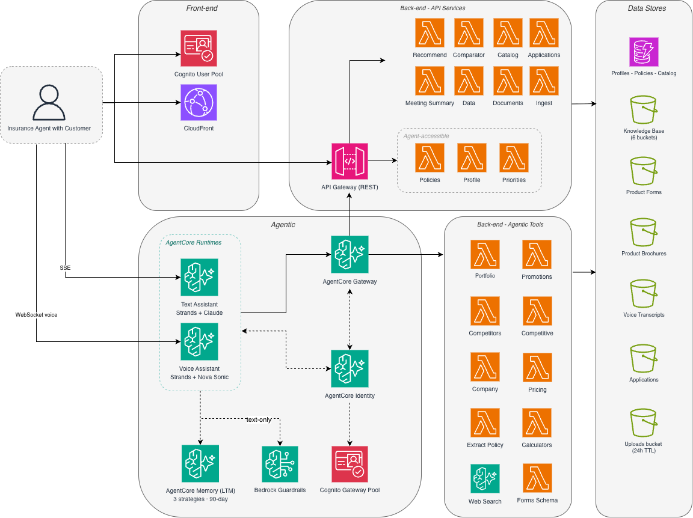

# Frictionless Insurance Advisor

**Frictionless Insurance Advisor** is an AI co-pilot for insurance advisors at the fictional Awesome Insurance, built end-to-end on Amazon Bedrock AgentCore.

> An AI co-pilot that gives every advisor instant, coverage-aware insight into each customer's portfolio, products, and competitors — so they walk into every conversation already prepared.

**Learn more:** read the AWS Industries blog post [Building a frictionless insurance advisor with Amazon Bedrock AgentCore](https://aws.amazon.com/blogs/industries/building-a-frictionless-insurance-advisor-with-amazon-bedrock-agentcore/), and see the [Frictionless Insurance Distribution Accelerator](https://view.highspot.com/viewer/b84c1dab273b1537f295e34317b868dc) page.


> **Sample code, not production software.** Awesome Insurance, its products, the competitors (BigRival, Brookmere, QuickSafe, Corvane Assurance), the customers and every document in `s3-data/` are fictional and exist only for this demonstration; any resemblance to a real company or person is coincidental. The assistants' output is illustrative and meant for the advisor, not advice to end customers, and it is no substitute for professional, compliance or legal review; the advisor remains responsible for suitability. The assistants are set up not to give tax or legal advice. Deploying this for real use needs your own compliance review first. Read [Security posture](#security-posture) and [Limitations](#limitations) before adapting any of it. Deploying creates billable AWS resources (Amazon Bedrock, Bedrock AgentCore, Lambda, API Gateway, CloudFront, DynamoDB, S3 and others): run `./destroy.sh` when you are done, and see [Teardown](#teardown).

Advisors sign in to a React app and either chat with the agent or talk to it in real time. The agent reaches across twenty MCP tools on the AgentCore Gateway: customer profiles and notes, policies, the Awesome product catalog, current promotions, company facts, competitive talking points, competitor product references, policy-document extraction, application-form schemas, pricing tables, indicative premium estimates, savings-gap calculators, the advisor's priorities for the day and a web search for general insurance questions. It answers from real customer data and cites the documents or web pages it used. It tracks the third-party policies a customer holds elsewhere so cross-sell suggestions stay coverage-aware, can onboard a brand-new prospect just by talking, reads uploaded policy documents (PDF / image / markdown) into structured fields the advisor confirms before saving, and remembers context per customer across sessions through AgentCore Memory.

On top of chat, the advisor gets a one-click meeting-prep brief, application forms for ten Awesome products that the text or voice assistant fills in from the conversation (with a printable PDF), indicative premium estimates with an affordability check, and customer notes that the assistant can add when asked. Separate comparator and recommender Lambdas generate side-by-side product views (with carrier financial-strength ratings, a customer handout PDF and an optional uploaded competitor brochure) and structured coverage-gap analyses with a dollar exposure per gap. A built-in data explorer lets the advisor read the same reference documents the agent is grounded in, the advisor's own voice transcripts, which are saved only after the customer's recording consent is confirmed and expire after one day, and the application forms the advisor has saved with Send for Signature, which are demo data and are deleted after 2 days.

The app is available in **ten languages**. The UI, the Text Assistant, the comparator and the recommender follow the language chosen in the switcher. The Voice Assistant replies in the language the advisor speaks, from a fixed list of seven (English, Spanish, French, German, Italian, Portuguese and Hindi), and a meeting note is drafted in the language of the conversation. The pitch deck is available in the same ten languages (see [Sales pitch deck](#sales-pitch-deck)).

## Why it matters

| For the advisor | For the customer | For the business |
|---|---|---|
| No more portal-flipping. Profile, gaps, promos, and competitive answers ready the moment a customer is selected. Drag a competitor PDF in and the policy is on file in seconds. | Faster, more personal meetings. Advice grounded in actual coverage. Confident answers about competitors. | Shorter prep time. Higher-quality cross-sell. Faster new-advisor ramp. PII, compliance and "estimates, never binding quotes" boundaries baked in. |

## Models

| Surface | Model | Why |
|---|---|---|
| Conversational text agent | Anthropic **Claude Haiku 5.5** | Fast, low-cost multi-turn reasoning with tool use |
| Voice agent | Amazon **Nova 2.5 Sonic** | Bidirectional voice with low end-to-end latency |
| Comparator, recommender and meeting-summary Lambdas | Anthropic **Claude Haiku 5.5** | Structured output through a forced tool call |
| Policy-document extraction, competitor-brochure reading | Anthropic **Claude Haiku 5.5** | Reads PDFs and images directly and fills a fixed schema |

All Claude calls use the `us.anthropic.claude-haiku-5-5` cross-region inference profile (one constant, `TEXT_MODEL_ID`, in `cdk/tools_stack.py`; the agent has its own in `agent/app.py`). Two things about this model matter when changing code:

- **It rejects `temperature`.** The Lambdas send no sampling parameters; a forced tool choice is what keeps the output on its schema.
- **It thinks by default.** The text agent turns thinking off and sets an explicit output limit (12,000 tokens). Without that, long answers such as a meeting brief stop at the default limit with no text.

AgentCore Memory runs its own service-managed extraction models; they are not configured in this repo.

## Architecture



> Rendered from the `architecture.drawio` source.

```
       React + Vite SPA                                Cognito user pool
       (CloudFront-hosted, or `npm run dev` locally)   (advisors)
                │
                │  Cognito JWT (Bearer)
                │
                ├─────────────────────────────────────────────────────┐
                │                                                     │
                ▼                                                     ▼
   AgentCore Runtime (text)                              API Gateway + WAF
   AgentCore Runtime (voice)                             (profile, policy,
   container · ARM64                                     catalog, comparator,
   Strands · Haiku 5.5 / Nova 2.5 Sonic                      recommend, signup,
                │                                        documents, data)
                │  M2M JWT via AgentCore Identity Token Vault
                │  + the advisor's own Cognito token (X-Advisor-Token)
                ▼
   AgentCore Gateway (MCP, 12 targets · 20 tools)
   request interceptor λ: verifies the advisor's token before every tool call
                │
                ├── advisor's token → API Gateway → λ profile (incl. notes), λ policies, λ priorities → DynamoDB
                ├── IAM    → λ portfolio · promotions · company · competitive · competitors → S3
                ├── IAM    → λ formschema · pricing table · premium estimate → S3 (+ DynamoDB for affordability)
                ├── IAM    → λ extract_policy → S3 (uploaded docs) → Bedrock (Claude Haiku 5.5)
                └── IAM    → AgentCore web-search connector (text agent only)
                ▲
                │  + AgentCore Memory (summaries · preferences · facts)
                │  + Bedrock Guardrail (content + topics + grounding + PII; text agent and Lambdas, not voice)
                │  + voice transcripts → private S3 bucket (1 day, after consent)
```

## CDK stacks

Five stacks, deployed in order:

| Stack | Purpose |
|---|---|
| `insadv-01-auth` | Cognito user pool (advisors) + gateway pool (M2M) + app + runtime + gateway clients |
| `insadv-02-tools` | DynamoDB profiles + policies + catalog tables; 23 Lambdas (22 unless deployed with `enable_public_signup`, which adds `signup`; profile, policies, portfolio, promotions, company, competitive, competitors, catalog, comparator, comparator_ingest, recommend, signup, documents, extract_policy, formschema, pricing table, pricing estimate, data, mock_data, priorities, meeting_summary, calculators, applications); API Gateway with WAF (rate-limited /signup); private S3 buckets for the knowledge bases (portfolio, company, competitive, competitors, promotions), application forms, pricing tables, PDF brochures, uploaded documents (1-day expiry), voice transcripts (1-day expiry) and saved applications (2-day expiry); **shared Bedrock Guardrail** used by six Claude surfaces (the text runtime and five Lambdas), not by the voice runtime; AWS Budget on Bedrock, Bedrock AgentCore and Lambda spend; KMS key for log encryption |
| `insadv-03-agentcore` | AgentCore Runtime (Claude Haiku 5.5 text agent), Gateway with twelve targets (twenty tools, including the web-search connector), AgentCore Identity OAuth2 credential providers, long-term memory (summary + preference + semantic strategies, 90-day TTL) |
| `insadv-04-voice` | AgentCore Runtime (Nova 2.5 Sonic voice agent), shares the same gateway, memory and Cognito as the text runtime, with no guardrail (see Bedrock Guardrail). Built on the stable `strands.bidi` API with pinned dependencies (`voice-agent/requirements.txt`, full set in `constraints.txt`) and OpenTelemetry traces with the conversation content redacted |
| `insadv-05-frontend` | S3 site bucket + CloudFront distribution with Origin Access Control hosting the React build |

`deploy.sh` handles the ordering: backend stacks first (parallel where the DAG allows via `--concurrency 4`), then `npm run build` against fresh SSM env vars, then the frontend stack. The frontend stack only synthesises after `react-frontend/dist/` exists, so a cold `cdk deploy insadv-01-auth` still works on a clean checkout.

Both AgentCore runtimes are plain `AWS::BedrockAgentCore::Runtime` resources (L1 `CfnRuntime`). `requestHeaderConfiguration` is a CloudFormation property, so the allowlist that forwards the `Authorization` header into the container is declared in the stack, and no post-deploy reconciliation is needed.

**Platform version.** Both AgentCore runtimes run on platform V2 (`platform_version="V2"` in `cdk/agentcore_stack.py` and `cdk/voice_stack.py`). V2 is the default for runtimes created without a platform version, so a fresh deployment (a new account, or a replaced runtime) lands on V2 anyway; the CDK files state the version explicitly, because on an update leaving the property out keeps the current version. Moving an existing runtime to V2 is an in-place update: the runtime ids and ARNs do not change, so the frontend needs no change. V2 starts a session by restoring a memory snapshot that the platform takes once per runtime version. New sessions start reliably (including sessions started 45 minutes and more after the snapshot), no OpenTelemetry span id repeats across sessions, and data is not mixed between two advisors. Measured behaviour: a new text session with the browser's warm-up request first (what the Text Assistant does) gets its first token after about 4.1 s at the median, the same on V1 and on V2; when the first message of a new session arrives with no warm-up, V2 is about 1.6 s slower (median 6.1 s against 4.5 s), because the platform restore happens before the container sees the request. The voice WebSocket handshake of a new session takes about 3.0 s at the median on V2 against 8.6 s on V1. Trace and span ids are unique across sessions (they are drawn from the OS, see the rules below), but `service.instance.id` is frozen by the snapshot, so the CloudWatch GenAI console groups many sessions under only a few instance ids; that is cosmetic. Idle behaviour on V2 (text, idle timeout 30 minutes): after 20 minutes idle the next message goes to the same container; after 31 minutes it goes to a new container started from the snapshot, and the conversation comes back from AgentCore Memory. The voice runtime's idle timeout is 15 minutes. **To run on V1 instead**, set `platform_version="V1"` in both files (explicitly; do not delete the line, because leaving it out keeps V2) and redeploy `insadv-03-agentcore` and `insadv-04-voice`. A V1 update takes seconds and a V2 update takes about 3 minutes (the platform builds a snapshot), which is also how to tell which platform an update landed on; check `platformVersion` in `aws bedrock-agentcore-control get-agent-runtime`. Two behaviours of V2 shape the code, and the rules below cover both: OpenTelemetry trace and span ids repeat across sessions if the id generators are seeded before the snapshot, and the platform can open the voice WebSocket twice for one client connection, so two handlers run in one process and must not share one Nova Sonic model or any per-session state.

**Snapshot-safety rules (for anyone changing `agent/` or `voice-agent/`).** On platform V2 the runtime starts the container once per version, takes a snapshot after the first healthy `/ping`, and restores every new session from it. Everything created before the first request is frozen and then identical in every session. So at import time (module level) do not: start a thread; open a socket, connection pool or WebSocket; fetch or keep credentials, tokens or JWKS keys; fill a cache; seed or draw random numbers or ids; capture `time.monotonic()` or `time.time()` as a base for expiry. Build such things lazily on the first request, or per connection. Loading imports and building boto3 clients without calling AWS is fine (the AWS guidance for startup). Rules in the code today: OpenTelemetry trace and span ids are drawn from the OS (`_draw_otel_ids_from_os()` at the top of both `app.py` files); cache ages use the wall clock and an entry from the "future" or older than its lifetime is dropped (`agent/container_cache.py`: `TTLCache`, `is_fresh`, the signing-key client); the PII mask client is created by the first chat message in a background thread, not at import (`INPUT_MASK_PREWARM=0` turns that off); the voice model and session state are built per WebSocket connection; per-user and per-session state stays in the request handler or in caches keyed by the token subject.

**Text assistant request flow and warm-up.** Each chat session id has its own container (a microVM on V2), and the text runtime keeps small caches in it (`agent/container_cache.py`): the Cognito signing keys, the advisor's email per token subject (5 minutes), and the started gateway connection with its tool list per token subject (10 minutes; never past the expiry of the advisor's token or the gateway token). The advisor's token is still verified on every message. Per message, the typed text is masked first (see [Typed PII is masked before it is stored](#typed-pii-is-masked-before-it-is-stored)); the advisor lookup, gateway connection and model client are set up concurrently with that, and the memory session manager and the long-term memory lookup start as soon as the masked text is ready. The browser sends `{"warmup": true}` with the chat's session id when the Text Assistant opens (`react-frontend/src/lib/warmup.ts`, at most once per session id per 5 minutes, silent on failure); the runtime answers at once and fills the caches in the background, without reading or writing AgentCore Memory. The runtime's idle session timeout is 30 minutes (`lifecycle_configuration` in `cdk/agentcore_stack.py`, service default 15 minutes; maximum lifetime stays 8 hours). The `/summaries/{actorId}/*` memory lookup is deliberately not configured: the service rejects wildcard namespaces, so it would never return anything, and "fixing" it would put summaries into the prompt.

## Agent tools (MCP)

Twenty tools on twelve gateway targets (the profile, policy and priorities tools share one OpenAPI target). A client that lists the gateway's tools sees 21, because the gateway has semantic tool search switched on, which adds its built-in `x_amz_bedrock_agentcore_search` tool to the twenty defined here. The voice runtime drops `WebSearch`, so its log reads "Loaded 20 gateway tools". Awesome reference data is read-only. The agent can write only three kinds of records: prospect onboarding, third-party policy tracking, and customer notes, each after the advisor asks or confirms.

| Tool | Source | Purpose |
|---|---|---|
| `get_profile` / `create_profile` / `update_profile` | Profile Lambda → DynamoDB | Customer profile read + prospect onboarding |
| `add_note` | Profile Lambda → DynamoDB | Saves a life-event or interaction note on a customer (source `assistant`). Only when the advisor's own message asks for a note or says yes right after the assistant offers one; a code guard in the agent cancels the call otherwise. There is no delete tool |
| `get_policy` / `create_third_party_policy` / `update_third_party_policy` / `delete_third_party_policy` | Policies Lambda → DynamoDB | Customer policy read + third-party policy CRUD (Awesome-issued policies stay read-only). Every policy carries `annual_premium` and `days_until_renewal`; with `include_totals=true` the answer is `{policies, totals}` (yearly totals for Awesome and other insurers, renewals in date order, share of income against the 10% guide), all computed in code |
| `get_priorities` | Priorities Lambda → DynamoDB | The advisor's ranked to-do list: review overdue, life event coming up or just passed, renewal due or missed, premiums over the 10% guide, prospect gone quiet. Rules and scores are computed in code; no model is involved |
| `get_portfolio` | Portfolio Lambda → S3 | Awesome product catalog, including a "unique features" paragraph per product |
| `get_promotions` | Promotions Lambda → S3 | Current promotions |
| `get_company_info` | Company Lambda → S3 | Awesome: history, credentials and carrier ratings, claims, support |
| `get_competitive_info` | Competitive Lambda → S3 | Awesome's competitive talking points and head-to-head Q&A |
| `get_competitor_products` | Competitors Lambda → S3 | Reference info on fictional competitors BigRival, Brookmere, QuickSafe |
| `extract_policy_from_document` | Extract Policy Lambda → S3 + Bedrock | Reads an uploaded PDF/image/markdown and returns structured policy fields with defense-in-depth validators (numeric clamps, date sanity, injection-keyword heuristic, insurer rejection) The policy `type` it returns uses the app's own names (Life Insurance, Critical Illness Insurance, ...), and the policies Lambda also maps short or loose types onto those names on every write, so a policy never ends up as an unknown type. |
| `get_form_schema` | Form Schema Lambda → S3 | Application-form schema for any of the ten Awesome products (sections, fields, types, required flags). `product_type` is checked against an allowlist before it becomes an S3 key; unknown values return the published list so the agent can self-correct |
| `get_pricing_table` | Pricing Lambda → S3 | The indicative rate file for a product type, or the list of priced products and what each needs |
| `estimate_premium` | Pricing Lambda → S3 + DynamoDB | One priced configuration, computed in code, with the customer's age and gender taken from their record and a check of total yearly premiums against 10% of income |
| `calculate_savings_gap` | Calculators Lambda | Education and retirement savings-gap scenarios. All compound-growth maths runs in code; every answer lists its assumptions (defaults in `lambda/calculators/assumptions.json`, overridable per call) and carries an illustration disclaimer |
| `WebSearch` | AgentCore web-search connector | General insurance questions the Awesome documents do not cover. **Text agent only**: the voice agent drops this tool at start-up. Social-media and forum domains are excluded |

The text and voice agents also have two local tools, `open_application_form` and `fill_form_field` (see Application forms). They need the browser connection in scope, so they cannot be gateway tools.

The comparator (side-by-side product table), the competitor-brochure reader and the recommender (coverage-gap analysis) are direct Bedrock Converse calls from their own Lambdas behind the API Gateway, not MCP tools. They are one-shot structured generations that do not benefit from the runtime's tool-use loop.

### Sources on every answer

When an answer uses Awesome documents or web results, the text assistant ends with a **Sources** footer. It is built in code (`agent/sources.py`), not by the model: the footer lists only what the turn's tools actually returned **and** that the answer names by path or URL, so the model cannot add a link of its own. Document chips open Data Explorer on that file in a new browser tab, so the chat on screen is left as it is; web chips open the page. Premium and rate answers cite the rate file.

Web search is the last resort: customer data first, Awesome documents second, the web only for general questions. It is never used for Awesome products, prices, ratings, promotions, forms or customers, nor to price or describe a named competitor product (even if asked), and queries carry no customer details.

## Frontend surfaces

Five tabs in the React app, each lazy-loaded. **Home** is the first tab and the page shown after sign-in:

| Tab | Backed by | What the advisor does |
|---|---|---|
| **Home** | `priorities` Lambda, customer list | The customer list on the left and the **Cockpit** (today's priorities) across the full remaining width. There is no assistant panel here. Clicking a customer, in the list or with a Cockpit button, opens the Text Assistant for that customer |
| **Text Assistant** | AgentCore text runtime (SSE) | Streaming chat with a Sources footer, per-customer history, document upload, "New Prospect" onboarding, a one-click **meeting-prep** quick prompt, pricing estimates with a rate card, and application forms that open beside the chat and fill from the conversation |
| **Voice Assistant** | AgentCore voice runtime (WebSocket) | Real-time voice with barge-in, a recording-consent bar, and a self-filling application form |
| **Comparator** | Comparator + recommender Lambdas | Side-by-side view of 2-4 products with carrier financial-strength ratings, a customer handout PDF, an optional uploaded competitor brochure (or one of eleven samples); per-customer coverage-gap analysis with dollar exposure |
| **Data Explorer** | `data` Lambda → S3 | Browse and read the reference documents the agent is grounded in, rate cards, PDF brochures, and the advisor's own voice transcripts and saved applications |

The customer sidebar on the Home, Text and Voice tabs (the Text and Voice tabs show the selected customer's profile with a collapsible **Show details** section for the remaining fields such as date of birth, income, tobacco status and net worth, policies, and a **Notes** card for life events and interactions), dark-mode toggle, language switcher, and a pitch-deck link are shared across tabs. The selected customer is shared too: pick one on the Text tab, switch to Voice and that customer's view is still open, and the other way round (a new prospect carries over as well). The Home tab and the logo behave the same: both return to Home and clear the selection (customer, prospect in progress and any pending link), so no customer is highlighted in the sidebar. Voice is reached only through its own tab: choosing a customer on Home or in the Cockpit always opens the Text Assistant. If you open the Text or Voice tab with no customer selected, the customer list stays in the sidebar and the main area asks you to pick one (with a **+ New Prospect** button). The Text Assistant keeps its on-screen chat, and a response that is still streaming, when you switch to another tab and come back, because the page stays loaded in the background once it has been opened; that chat is held in memory only, so reloading the page or signing out clears it (the agent's memory on the server persists per customer). The Home tab and the logo clear the selection but keep the open Text chats: choose the same customer again and the conversation is still there (the chat state is held by the Text page, not by the chat panel that is hidden while nothing is selected). The same goes for a message you have typed but not sent: it is kept per customer (and for a new prospect), so it is still in the box when you come back to that customer after the Home tab, the logo or another tab, and it never shows for another customer. Sending the message clears it. Drafts are held in memory only, never stored in the browser, and reloading the page or signing out clears them. The Voice Assistant does not stay in the background: leaving its tab ends the voice session and clears its on-screen messages. The selected customer is held in memory only too, so a reload starts on the Home tab. Panel sizes and sidebar state persist to `localStorage`.

**Cockpit (today's priorities).** The Home tab lists the customers who most need attention, most urgent first, each with the reason and a one-click action that opens the customer and starts that prompt: **Draft email** when the strongest reason is a date to reach out about (a life event, a renewal, a quiet prospect), **Annual review** when the file needs attention (a stale review, premiums over the 10% guide, or a renewal on a file that is also due for review), and **Prepare meeting** for a prospect with no Awesome cover. The Cockpit buttons (Annual review, Prepare meeting, Draft email) open the Text Assistant for that customer and send the starter prompt once. The Cockpit is shown on the Home tab only. The button reloads the list from the service; nothing is stored. The ranking comes from `lambda/priorities` (`GET /priorities`); the assistants answer "what should I do today?" from the same list through `get_priorities`.

**Annual review, outreach drafts, meeting notes, options, market pulse, savings goals.** Prompt-level features of the text assistant: an annual-review pack (policies table with renewals, notes since the last review, ranked gaps, affordability from the service's totals, next steps), two drafted messages (warmer and more direct; the app never sends anything), a Summary / Concerns / Next actions note from a recap (saved only after the advisor says yes), up to three priced options via `estimate_premium`, an on-demand market digest from web search, and education / retirement savings-gap answers from `calculate_savings_gap`. Anything that projects or illustrates ends with an "illustration, not a quote or a promise" line.

**Pause and resume voice chat.** The voice header has one button: **Start voice chat**, then **Pause voice chat** while the microphone is on, then **Resume voice chat**. Pausing releases the microphone and cuts the assistant's voice at once, including the audio already queued; text that was being held back to match the sound appears immediately. The session stays open, so the transcript, consent and any open form carry on, typing still works, and the assistant's replies come as text only. The status reads "Paused" and the button shows a countdown from 5:00, because the voice model ends a session after about 5 minutes with no speech and no typing (typing a message restarts the countdown). If the session has ended by the time you resume, Resume opens a new one, says so, and asks the recording-consent question again. There is no separate speaker mute; the assistant's voice is silenced only while paused. The server is not paused: the assistant can still finish a sentence or fill a form field that nobody hears.

**Meeting note from a voice session.** On the Voice tab, once recording consent is confirmed and something has been said, **Summarise into a note** sends the conversation to `POST /meeting-summary` (`lambda/meeting_summary`, forced tool call, shared guardrail). The advisor gets an editable Summary / Concerns / Next actions draft (at most 1,000 characters) and presses Save, which uses the ordinary notes route as the advisor. The assistant never writes this note, and the conversation text is neither stored nor logged by the Lambda.

**Meeting prep.** The quick prompt "Help me prepare for my meeting with this customer" returns a fixed-structure brief: customer snapshot, meeting goals, discovery questions, products to discuss, objection handling (as a table) and a close with next step. It draws on the customer's notes, third-party policies, promotions and competitor material, and ends with its sources.

**Customer notes.** Notes are typed (`life_event` or `interaction`), up to 1,000 characters, at most 100 per profile. The advisor adds and deletes them in the Notes card; the assistant can add one (labelled "Added by assistant") but never delete. The API route for adding accepts both the sign-in and the gateway token; the delete route accepts only the sign-in token.

### Data explorer

The Data Explorer tab is a read-only window onto the same `s3-data` corpus the agent reads, so an advisor can check the underlying source rather than taking a generated answer on faith. It also shows the advisor's own voice transcripts, scoped to the signed-in advisor.

Ten folders are surfaced: Product Portfolio, Company Info, Competitive Positioning, Competitor Products, Promotions, Application Forms, Pricing Tables, Brochures, Voice transcripts and Saved applications. The first eight are allowlisted and ordered server-side in the `data` Lambda; `mock-policies` is deliberately excluded because those are served as static downloads instead. Text folders show only `.md` and `.json`.

- The file listing is fetched once (metadata only); document bodies load lazily per selection and are cached for the session.
- Markdown renders at full document type scale, with front matter stripped and shown as a "Last updated" line.
- **Form-schema JSON gets a real rendered view** (section cards listing each field's label, type, required flag, dotted path, hint, and options) with a Rendered/Raw toggle for the source.
- **Carrier ratings get a table**: `competitors/carrier_ratings.json` shows one row per carrier and one column per agency (AM Best, S&P, Moody's) with rating, label and outlook, an "Illustrative" tag on the fictitious competitors, and the as-of date. It is the file the Comparator's ratings row reads.
- **The folder list folds.** Each folder in the left column has a chevron to collapse or expand it, and a Collapse all / Expand all link sits next to the file count. The choice is remembered in the browser. A search shows every match regardless, and opening a document from a link reopens its folder.
- **Pricing tables get a rendered rate card**: age bands, rates per unit of cover, factors, add-ons, what the price depends on, and an "Indicative only" label.
- **Brochures** are ten one-page Awesome PDFs with no prices, shown in an in-page viewer with Open and Download. They are served through 2-minute presigned S3 links, so no binary passes through API Gateway. No agent role can read the brochures bucket.
- **Voice transcripts** list the advisor's sessions newest first (date and time, customer or Prospect, turn count, "in progress" while open) and open in a chat-style view with times, a "typed" marker, the customer for each stretch, and a banner with the expiry rule and consent time. Refresh reloads a live session; Raw shows the JSON.
- **Saved applications** list the advisor's own saved forms newest first (reference, customer or Prospect, time) and open in a read-only view: reference, product, customer, every answer with its readable value, where it came from (profile, conversation or entered by hand), a Hidden tag for answers the form's rules had hidden, a note of what was not stored, and the retention rule. Like transcripts, the folder is scoped to the signed-in advisor from the verified token, and another advisor's key is a 404.
- Search filters across filename, sub-path, and folder label.
- `competitive` and `competitors` documents carry an **Internal Use Only** badge so a battlecard doesn't get screen-shared to a customer.

Content reaches the browser through API Gateway and the `data` Lambda, authorized with the same Cognito JWT as every other API route. Nothing is bundled into the SPA and the browser never touches S3 directly, so the knowledge-base buckets stay private.

## Application forms (text and voice)

When the advisor and customer agree to start an application, an application form opens beside the chat (text assistant) or takes over the left panel (voice assistant) and fills itself from the conversation and the customer's record. Both agents fill forms the same way. In voice the advisor keeps talking and fields land as they speak.

**Ten Awesome products** have published forms, each backed by a JSON schema in S3 (`s3-data/forms/`). Files are named after the product's portfolio file, `<product>-form.json` (for example `awesome-disability-form.json`); the product type (`term_life`, `disability`, ...) stays the identifier the tools use, and each service holds the type-to-file map that doubles as the S3 key allowlist:

| `product_type` | Product |
|---|---|
| `term_life` | Awesome Term Life |
| `whole_life` | Awesome Whole Life |
| `universal_life` | Awesome Universal Life |
| `variable_life` | Awesome Variable Life |
| `critical_illness` | Awesome Critical Illness |
| `health` | Awesome Health |
| `home` | Awesome Home Insurance |
| `auto` | Awesome Motor |
| `travel` | Awesome Travel |
| `disability` | Awesome Disability |

**Answers carry over when the product changes.** Field state is keyed on the dotted path and deliberately not cleared when the product changes. Nine of the forms share seven applicant fields (name, date of birth, address, phone, email, occupation, income), and the term, whole and variable life forms share most of their paths, so moving between them leaves only the product-specific fields outstanding. The tool tells the agent exactly what carried over so it does not re-ask. The Universal Life form is the exception: it is a longer application with its own paths (see below), so answers do not carry to or from it. The only sensitive identifier any form holds is the Universal Life Social Security number, which the assistants never touch. No form holds bank, card or licence-number fields.

**Tools, split by concern:**

| Tool | Where | Why |
|---|---|---|
| `get_form_schema` | Gateway target (shared) | Read-only data lookup. Answers "what does this application require?" without opening anything on screen |
| `open_application_form` | Local to each runtime | Reads the schema straight from S3 and sends it to the browser. Needs the connection in scope, so it cannot be a gateway tool |
| `fill_form_field` | Local to each runtime | Emits one field to the browser |

The schema is **never routed through the model**. `open_application_form` fetches from S3 server-side and sends it to the browser directly; the model only gets back a compact list of field paths and what is already known, worded as a plain description (instruction-style wording in a tool result can trip the guardrail's prompt-attack filter). Passing 20 fields of JSON back out as a tool argument would burn tokens twice and risk silent truncation or invented fields.

**Confidence drives the UI, not the data.** The model self-reports 0.0-1.0 per field. At 0.85 or more a field fills green; below that it fills amber with a "Looks right" confirm. Nothing is hidden from the advisor. These scores are a heuristic prompt signal, **not calibrated probabilities**. Values are clamped server-side and default to amber if malformed.

**Guards.** `fill_form_field` rejects any path not in the schema actually opened, and refuses outright if no form is open, because field paths originate from a model and the UI keys its state on them. `product_type` is allowlisted before it becomes an S3 key. In voice, form filling is also blocked until recording consent is confirmed.
**Universal Life application (85 fields).** `awesome-universal-life-form.json` is modelled on a guaranteed universal life application template, trimmed to what a customer can reasonably answer: coverage (3), proposed insured (17), owner and payor (5, optional), three beneficiaries (15, the first required), riders and premium (10), existing insurance and replacement (4), medical and lifestyle history (15 yes/no questions with details, 30) and net worth (1). Everything the insurer fills in (application number, channel, agent statement, underwriting decision, signatures) is left out. A typical applicant sees about 68 of the 85 fields: the 15 medical detail boxes appear only after a Yes, and the existing-cover total and replacement question only when the customer already holds life cover. The profile fills about 17 fields (name and address in parts, date of birth, marital status, citizenship, occupation, income, tobacco status, net worth), the policies table fills whether life cover exists and its total, and a current tobacco user answers medical question 9 (tobacco in the past 12 months) Yes. The Social Security number is `sensitive: "secret"` and the 30 medical fields are `sensitive: "health"`. The product itself matches: Awesome Universal Life carries a no-lapse guarantee to a chosen age and the six riders above (see Pricing). The option lists, the medical wording and the state variations are demo content and have not been reviewed by a business or compliance team. The template's "illustration received" acknowledgment is not a form field; it belongs on the signed paper application.

**Close and Fill demo data.** The form header has **Close** and, beside it with the same outline, **Fill demo data** (all ten forms). It puts the same fictional sample answers into the empty fields for every customer, so a form can be completed and Send for Signature tried without typing each field; answers already there (from the profile or the assistant) are kept, and a second press adds nothing. Fields that only appear after an answer are filled once they appear. Optional extras such as a second beneficiary, the owner and payor, and riders are left blank because a made-up value there would change what the application means. On the Universal Life form it also types a made-up Social Security number (000-12-3456) in the masked box, like the advisor would; that number is never sent to an assistant or stored. The button is for demonstrations and testing.

**Conditional and sensitive fields.** A field in a form definition may carry three optional keys, so one form can adapt to the answers given:

| Key | Meaning |
|---|---|
| `visible_when` | The field is shown only while the condition holds. No key: always shown |
| `required_when` | The field is required while the condition holds (and it is shown). `required: true` still means always required |
| `sensitive` | `"secret"`: the assistants never fill, read back or log it, it is typed on screen in a masked input and printed as its last four characters (the SSN). `"health"`: the assistants may fill it from the conversation, but its value is never written to a log |

A condition is a map of field path to expected value; every entry must match, an expected value may be a list ("any of"), and a list of maps means "any of these maps". Values compare as text (a boolean is `"true"` or `"false"`), and a field with no answer matches nothing. For example, a details box that appears and becomes required after a Yes: `"visible_when": {"medical.q1": "true"}, "required_when": {"medical.q1": "true"}`. A hidden field is never required, does not count toward progress or the Send gate, is not sent to the assistants and is left off the PDF; answers already typed into it are kept in case the customer changes their mind. The pricing files use the same `required_when` shape.

The rules are implemented three times with the same rules: `react-frontend/src/lib/formRules.ts` for the screen, and `agent/form_rules.py` with an identical copy in `voice-agent/form_rules.py` for the assistants. Change one, change all three. The assistants are told which fields apply now, which appear after an answer (with the condition in words), and which only the advisor types; a fill that makes more fields apply says so in its result. The browser never sends a secret field's value to the assistants, and the assistant runtimes drop it again if it arrives.

Precedence is **manual > conversation > profile**: fields known from the customer's record are prefilled and marked as such, the conversation can override them (a job change, say), and anything the advisor types by hand is never overwritten.

**Send for Signature** saves the whole application (see Saved applications below). **Download PDF** produces a printable application with the answers so far, unanswered lines left blank and a signature line for the applicant. The PDF libraries are loaded only when the button is used.

### Saved applications (Send for Signature)

**Send for Signature** saves the whole form as one JSON object through `POST /applications` (`lambda/applications`). It unlocks when every required field is answered. Nothing is sent to a customer or an e-signature service; the object is the deliverable.

- **Where it goes.** A private bucket made for this, keyed `<advisor>/<customer id>/<product type>/<time>-<ref>.json` (the advisor's address with `@` written as `_at_`, as for transcripts). A prospect with no record yet is saved under `_prospect` in place of the customer id. The first send creates an object. Sending the same application again (after **Edit again**, or after closing and reopening the form) overwrites it in place instead of adding another.
- **What is in it.** The reference (`APP-` and eight hex digits), time, product, form version, advisor, the customer (id and name, read from the profile and not from the request), a flat `answers` map for machines, and `sections` for people: every answered field with its label, readable value, where the value came from (profile, conversation or entered by hand) and whether the form's rules had it hidden when saved. Hidden answers are kept and flagged, in case they are wanted.
- **What is never in it.** A field marked `sensitive: "secret"` in the form definition (the Social Security number) is dropped on the server whatever the browser sends, and the object lists it as not stored. Answer values are never written to the logs. The 30 medical answers are stored like any other answer.
- **Checks on the server.** The advisor comes from the verified sign-in token (a machine token is refused). The customer must belong to that advisor. The product must be one of the ten published forms, every path must be a field of that form, and choices, yes/no answers and numbers must be valid. Whether the required fields are complete is checked by the button, not by the Lambda.
- **After saving.** The button shows Saved, the screen shows the reference, and the fields lock until **Edit again**. If the answers change in any other way after the save (an assistant fills a field, say), the form reopens and can be sent again.
- **Saving again overwrites.** The first save returns a reference (`APP-XXXXXXXX`) and the app remembers it for that customer and product for the rest of the signed-in visit, in the same shared form store that keeps the answers, so it survives closing the form and moving between the Text and Voice pages. The next send includes it as `ref`. The Lambda looks for that reference only in the signed-in advisor's own folder for that customer (or `_prospect`) and product, and replaces that object at the same key: the reference and `saved_at` stay, `updated_at` moves on and `revision` goes up by one (the response is 200 with `replaced: true`). If nothing matches (the earlier save has expired, or the reference belongs to someone else's, another customer's or another product's application) a new application and reference are created, so a reference can never be used to touch anything outside the caller's own folder. The reference is held in memory only, so after a page reload the next send is a new application. The Data Explorer shows a revision tag and the last update time on an application that has been saved more than once. The Lambda therefore also needs list and read access to the bucket, still limited to the advisor's prefix in code; it cannot delete.
- **Reading them back.** The Data Explorer's Saved applications folder lists the signed-in advisor's own objects and opens each in a read-only view. Only the `applications` Lambda can write the bucket, only it and the `data` Lambda can read it, and no agent tool has access.
- **Retention: demo data only.** A lifecycle rule expires every object 2 days after it was written (S3 expires at midnight UTC, so an object disappears 2 to 3 days after the save; saving again rewrites the object, so the clock restarts), and the bucket is deleted with the stack. There is no versioning. Do not treat it as a record of applications.

## Pricing and affordability

`get_pricing_table` and `estimate_premium` give the assistants indicative premiums for all ten products from rate files in S3 (`s3-data/pricing/<product>-pricing.json`, for example `awesome-term-life-pricing.json`, built by `tools/pricing/build_rates.py`). Each rate file describes its own inputs, tables and factors, so adding a product means adding a file.

- **All arithmetic runs in the Lambda.** The model chooses the inputs and reads the result back; it never multiplies a rate itself. Option values are validated against the rate file's definitions.
- **Age and gender come from the customer's record** (gender is a profile field), so the assistant does not ask for what it already knows.
- **Gender x age band.** Every product with an age-banded base table (the four life products, Critical Illness, Health and Disability) takes a gender input. The table value is the male reference; a female applicant gets a multiplier for her age band (a `when: {gender: female}` band factor in the rate file, shown in Data Explorer's rate card). The Health, Critical Illness and Disability multipliers are illustrative placeholders. Travel is priced by geography and trip length, Motor and Home by their own factors; none of them take gender.
- **Universal Life: guarantee and riders.** Awesome Universal Life has a no-lapse guarantee to a chosen age (90, 95, 100 or 121 for lifetime; a longer guarantee costs more) and six riders priced as percentage add-ons (waiver of premium, accidental death, long-term care / chronic illness, guaranteed purchase option, no-lapse guarantee rider, overloan protection). A rate file may carry a `reference` block, a second premium for the same choices with some inputs overridden; for Universal Life it is the **required no-lapse premium** (the premium level set to minimum), returned as `reference_premium` with every estimate and at the chosen frequency. The assistants warn, without blocking, when a planned premium on the application is below it. The rates and factors are illustrative.
- **Affordability.** When the customer is known, the total of all active yearly premiums, other insurers' included, plus the proposed one is compared with 10% of income. Missing income returns `income_unknown`.
- **Always an estimate.** Results and answers are labelled indicative; they are not quotes and nothing binds coverage. Premium answers cite the rate file.
- **Illustrations carry a closing line.** Both assistants end an answer that contains a projection, a what-if or a worked example with a short "illustration, not a quote or a promise" line (in the text assistant, above the Sources footer). Plain factual answers and premium estimates, which have their own disclaimer, do not get it.

## Voice runtime internals

The voice agent uses the stable `strands.bidi` API (`BidiAgent` and `BedrockNovaSonicModel`, `strands-agents` 1.59). The packages are pinned in `voice-agent/requirements.txt` because the library's bidi interface has changed between releases (events, class names, how a conversation is stopped). To upgrade, bump the pins and re-run a voice session end to end.
- **Model.** `amazon.nova-2-5-sonic` (Nova 2.5 Sonic), set once as `MODEL_ID` in `cdk/voice_stack.py`, which feeds both the runtime's environment and its IAM policy. It has the same API surface, voices and languages as Nova 2 Sonic (`amazon.nova-2-sonic-v1:0`), and runs on demand in us-east-1 (no inference profile). Against Nova 2 Sonic, in a side-by-side run of the same tool-calling question (5 trials each), it calls the tool in about 0.66 s against 0.81 s and begins speaking after about 1.27 s against 1.62 s, with the correct tool argument and the correct figure in the answer every time.

- **Browser protocol is ours.** The browser sends `bidi_audio_input` / `bidi_text_input` / `voice_*` messages and receives `bidi_audio_stream`, `bidi_transcript_stream`, `bidi_interruption`, `consent` and form messages. `voice-agent/wire.py` is the only place that translates to and from the library's events, so a library change does not reach the frontend.
- **Stopping.** "Stop conversation" is a local tool that calls `agent.cancel()`, the library's way to end a session after the current tool call.
- **Connection limits.** Nova Sonic caps one connection at about 8 minutes, so the library restarts it proactively at 7 minutes and replays the conversation. A 12-minute session with questions before and after the restart keeps its context, and with the restart interval shortened to 25 seconds the conversation context and a tool call both survive the restart. Separately, Nova Sonic ends a session after about 5 minutes with no speech and no typed message (silent audio frames do not count).

### Voice session end at token expiry

The voice runtime verifies the advisor's access token once, when the socket opens. A timer then closes the socket at the token's `exp` with close code `4401` (the application range 4000-4999; the constant `TOKEN_EXPIRED_CLOSE_CODE` in `voice-agent/app.py` and `VOICE_TOKEN_EXPIRED_CLOSE_CODE` in `react-frontend/src/lib/voice.ts`) and the reason `Session expired`. Every voice connection starts with a newly refreshed access token, so a session normally runs for the token's full 30 minutes. At the close the page keeps the conversation on screen, turns the microphone off and opens a new session with another refreshed token, and shows a notice that consent is asked again. If a second expiry close arrives within 30 seconds, or no fresh token can be obtained, it stops and tells the advisor to sign in again. The token's expiry therefore bounds a voice session at 30 minutes, the same as the 30-minute session limit.

## Recording consent and voice transcripts

The voice assistant asks, when the advisor first starts the microphone, "Before we start, can you confirm {customer} has agreed to this conversation being transcribed, and to key points from it being kept in memory for later conversations?" The advisor answers with the Confirmed / Declined buttons in the bar above the chat. Those buttons send the browser's consent message, which the runtime handles on the server; the model has no tool that can set consent, so a spoken yes or no does not count. Consent is per session and per customer. Transcripts are kept for a day; conversation events in AgentCore Memory expire after 90 days, and facts extracted from them can stay longer.

- **Until confirmed, three things are blocked in code:** memory writes (a session manager that refuses to create events), form filling, and transcript storage.
- **Declined** ends the session, clears the on-screen conversation and writes nothing.
- **Switching customer** resets consent and the question is asked again, because a different person is being discussed. The state remembers which customer it was given for, so going from one customer to nobody and then to another also resets it. The consent itself is recorded only in the transcript header and shown in the bar above the chat; nothing is added to the customer's notes. The only note a voice session produces is the on-demand one described above, which the advisor must edit and save.
- **Transcripts** are saved as `<advisor>/<start>-<session>.json` to a private bucket about every 30 seconds while there are new turns, and once more on close. Objects expire after one day (they disappear 24 to 48 hours after the last write). The voice runtime can only `PutObject`; the `data` Lambda can only read, and only the signed-in advisor's prefix, identified from the verified token; no agent tool has access. Transcript text is not written to logs.
- The advisor reads them in the Data Explorer tab ("Voice transcripts").

## Bedrock Guardrail

A single shared guardrail (`insurance-advisor-guardrail-shared`) lives in `insadv-02-tools` and gates the six Claude surfaces: the text agent, the comparator Lambda, the brochure reader, the recommender Lambda, the extract_policy Lambda and the meeting-summary Lambda. The same policy, applied six ways. **The voice agent is not covered**: the Nova Sonic bidirectional stream has no guardrail setting (guardrail keys passed to the model's client are ignored by the library, so none are passed), so voice relies on its system prompt, the tool-level checks and Sonic's built-in safety filters. See [Why the voice assistant has no guardrail](#why-the-voice-assistant-has-no-guardrail). The published version is written to SSM (`/insadv/bedrock/guardrail-version`) on every policy change so all callers pick up updates on cold start without a runtime redeploy.

| Policy | Configuration |
|---|---|
| Content filters | `SEXUAL`, `VIOLENCE`, `HATE`, `INSULTS` at HIGH input + HIGH output. `MISCONDUCT` at **LOW** input + LOW output (see below). `PROMPT_ATTACK` at **MEDIUM** input only (output NONE). |
| PII anonymized, in the user's message (both stream modes) and in the model's reply (`sync` stream mode only, see [Guardrail stream mode](#guardrail-stream-mode-async-by-default)) | `US_SOCIAL_SECURITY_NUMBER`, `CREDIT_DEBIT_CARD_NUMBER`, `US_BANK_ACCOUNT_NUMBER`, `CREDIT_DEBIT_CARD_CVV`, `CREDIT_DEBIT_CARD_EXPIRY`, `PIN`, `INTERNATIONAL_BANK_ACCOUNT_NUMBER`, `SWIFT_CODE`, `US_PASSPORT_NUMBER`, `DRIVER_ID`, `US_INDIVIDUAL_TAX_IDENTIFICATION_NUMBER`. |
| PII blocked (whole request refused) | `PASSWORD`, `AWS_ACCESS_KEY`, `AWS_SECRET_KEY`. |
| PII not anonymized — by design | `NAME`, `EMAIL`, `PHONE`, `ADDRESS`, `AGE`, `DATE_OF_BIRTH`. These are integral to legitimate advisor workflows; output-side log redaction is the right place for those. |
| Word policy | AWS-managed `PROFANITY` list. |
| Denied topics | `LegalAdvice` and `TaxAdvice`, both `DENY`. They block the advisor's input and only detect on output (the finding is logged and the answer is delivered), because the classifier also fires on market news about lawsuits, rulings and tax law. There is no investment or financial-advice topic: the assistants may give general financial guidance to the advisor (see below). |
| Contextual grounding | `GROUNDING` ≥ 0.75, `RELEVANCE` ≥ 0.5. Active on the comparator + recommender Lambdas (which tag their source markdown / customer profile / catalog as `grounding_source`) and the uploaded-brochure comparison; attached but inert on the text runtime (Strands tool results aren't tagged as sources). |

Interventions surface as a clean 400 (or, in chat, the configured `blocked_outputs_messaging`).

**PII masking works in both directions.** Each PII entity sets `inputAction`, `outputAction`, `inputEnabled` and `outputEnabled` explicitly (the `_pii()` helper in `cdk/tools_stack.py`). With only `action`, Bedrock masks what the model writes but not what the user typed. With all four set, a number typed into the chat, or sitting in a text document sent to the comparator, brochure reader, extract_policy or meeting-summary Lambdas, reaches the model as a placeholder such as `{US_SOCIAL_SECURITY_NUMBER}`, and, in `sync` stream mode only, a number the model writes is replaced before the user sees it (the Text Assistant runs `async` by default, where the model's own output is not masked; see [Guardrail stream mode](#guardrail-stream-mode-async-by-default)). The `PASSWORD` and AWS-key entities block the request in both directions. The SSN field on the application form is typed on screen in a masked input and is never sent to the assistants, so the form flow is not affected. Limits: the system prompt, tool arguments and tool results are not scanned; US bank routing numbers are not in the entity list; masking of text inside PDF and image blocks sent to the Lambdas was not tested; the text runtime's default stream mode is `async`, where PII the model writes is flagged but not masked (switch to `sync` to mask it). Known false positives: an 8-digit number after the word "account" (for example "customer account 48291506") is read as a bank account number, and the Japanese sentence "証券番号は123456789" is read as a passport number. The guardrail on the model call only hides a number from the model; keeping it out of AgentCore Memory and the logs is done by masking the message before the agent starts (next section).

**What a block looks like in the Text Assistant.** In `sync` stream mode an output-side block usually replaces the whole reply with the guardrail's canned sentence (Bedrock checks the answer in pieces, so text written before the flagged piece can still get through). In the default `async` mode the answer has normally streamed in full when the block lands, and the chat then replaces it with the translated notice (see [Guardrail stream mode](#guardrail-stream-mode-async-by-default)). The canned sentence reads "I'm sorry, I can't provide that response. Please ask me about insurance-related topics." It is intermittent because of what the model writes before it calls a tool. For a question such as "what should I propose first?" the model usually opens with one sentence in the same message as its tool calls ("I'll pull her profile and the portfolio so the recommendation is based on her record"). The guardrail judges that sentence on its own; when a filter or topic matches it, the replacement swallows the whole message, tool calls included, so the turn ends with the canned sentence before any data is read (a lead-in with "recommendation" or "suggesting" next to "portfolio" is the kind of text that matched a financial-advice topic, which is why there is none, see "Financial advice is allowed" below). Only the Text Assistant tab has the guardrail; the Voice tab runs on the voice runtime, which has none. The two chat panels are told apart by their headings, "Text Assistant - <name>" and "Voice Assistant - <name>". The text agent's system prompt therefore allows one fixed lead-in sentence before or between tool calls, "Checking the customer's record." written in the language of the reply, and nothing else, which the guardrail does not intervene on. The application-form flow has no lead-in at all.

- **Friendly message.** When the guardrail replaces an answer, the text runtime sends a `guardrail_blocked` event and the chat shows a translated sentence ("The compliance filter blocked that answer. Please try again or rephrase your question...") in place of the canned text. A runtime that sends no event leaves the canned text on screen. A blocked message is caught before the agent starts and is never stored. When the guardrail blocks the model's answer, Strands overwrites the user's message in AgentCore Memory with `[User input redacted.]`, and in `async` mode the answer with `[Assistant answer removed by the compliance filter.]`, so the next turn in the same chat starts from a redacted history. There is no automatic retry.
- **Log line.** On every intervened model call the text runtime writes one INFO line to its CloudWatch log group (`/aws/bedrock-agentcore/runtimes/insurance_advisor_agent-<id>-DEFAULT`): `Guardrail intervened (stop_reason=guardrail_intervened) blocked=True: output contentPolicy filter=HATE confidence=HIGH action=BLOCKED`. It names the side (input or output), the policy type and the topic name, content-filter type and confidence, or PII entity type, plus the action, and never the customer's text or the model's reply. Find it with `aws logs filter-log-events --log-group-name <group> --filter-pattern '"Guardrail intervened"'`. The code is in `agent/guardrail_trace.py`.

**Two deliberate relaxations, both for the demo.** There is no `UnderwritingDecisions` denied topic, because it blocks routine product questions such as "what are the eligibility rules?". The `MISCONDUCT` filter is at LOW because at HIGH it blocks harmless lead-in sentences in the text assistant's form flow ("I'll pull the profile and open the application to pre-fill what we know"), so the form often fails to open or fill. Clearly harmful requests (forged signatures, concealing a medical condition, a fabricated medical report) and prompt-extraction attempts are still refused. Not promising approvals, rate classes or claim payouts is enforced by the system prompts rather than a guardrail topic. A production build should revisit both.

**Financial advice is allowed.** There is no investment-recommendation denied topic, because a life insurance advisor gives financial advice, and such a topic blocks harmless replies (a lead-in with "recommendation" next to "portfolio") as well as genuine guidance. The text and voice system prompts let the assistants give general financial guidance to the advisor: needs analysis, how life insurance fits a financial plan, education and retirement funding, and protection versus savings-linked products (Whole, Universal, Variable Life) using the product sheets and the pricing tools. The prompts keep these rules: no promised or implied returns (except guarantees stated in the product sheet), projections and premiums labelled illustrative or indicative, no binding quote, no named third-party securities, funds or tickers, the advisor is responsible for suitability, and tax and legal questions go to a tax or legal professional. `LegalAdvice` and `TaxAdvice` stay denied. Confirm with your own compliance or legal team that giving financial advice through the assistants is permitted before using this outside a demo.

### Typed PII is masked before it is stored

The advisor's message is masked at the very top of `invoke()` in `agent/app.py`, before the Agent, AgentCore Memory or the OpenTelemetry logging see it (`agent/input_mask.py`). It calls the Bedrock `ApplyGuardrail` API (source INPUT) with the same guardrail and version as the model call, in a worker thread, in parallel with the other setup. Only the masked text goes to the model, to AgentCore Memory (events, and so the long-term summaries built from them), to the memory lookup and to the runtime's logs. An SSN, card number, card expiry and CVV, bank account, passport, driver licence or ITIN typed in the chat is stored as a placeholder such as `{US_SOCIAL_SECURITY_NUMBER}`. The guardrail on the model call stays on as a second layer.

- **What is not masked.** Names, addresses, dates of birth, phone numbers and emails are intentionally left as typed (they are what the assistant needs to fill forms and update profiles). Formats the guardrail does not recognise are not masked, and a card number with a mistyped digit fails the checksum and is not masked either. The known false positive is an 8-digit number after the word "account", which becomes a bank-account placeholder.
- **A message the guardrail blocks** (a password or AWS key, the legal-advice or tax-advice topic, a prompt attack) is answered at once with the guardrail's own sentence. The browser receives the sentence, the stop reason `guardrail_intervened`, then `guardrail_blocked`. The agent is not created, the model is not called, and nothing is read from or written to AgentCore Memory, so the blocked message is stored nowhere.
- **If the `ApplyGuardrail` call fails** (timeout, throttling, an error, or the guardrail id or version cannot be resolved), a local masker is used for that message and a WARNING with only the exception type is logged. It masks SSNs in the 3-2-4 shape (and nine digits right after "SSN" or "social security"), ITINs, card numbers that pass an issuer-prefix and Luhn check, IBANs that pass the mod-97 check, and a card's expiry and CVV when they sit next to a masked card number. The mask itself never refuses a turn (if the version is missing the model call is refused, see [Limits and failure behaviour](#limits-and-failure-behaviour)). The local masker is narrower than the guardrail: it misses spelled-out numbers, passports, licences and bank accounts.
- **Logs.** `Input mask: outcome=masked entities=US_SOCIAL_SECURITY_NUMBER elapsed_ms=140` is logged for each message (outcome, entity type names and time; never the text or the matched values). With `AGENT_LOG_LEVEL=DEBUG` the libraries log whole model requests; keep it at INFO with real data.
- **Retention.** AgentCore Memory events expire after 90 days. The text runtime's log group (`/aws/bedrock-agentcore/runtimes/<runtime id>-DEFAULT`) is kept for 90 days. It is created by the service, so `cdk/agentcore_stack.py` sets the retention with a custom resource that creates the group if it does not exist yet and then calls `PutRetentionPolicy`; it runs on first deploy and when the runtime id changes. Long-term memory records have no expiry of their own. The demo reset deletes the records and the events of every customer. `scripts/erase_customer_memory.sh <customer id>` erases the records and events of one customer (a dry run unless `--execute` is given); `scripts/wipe_memory_records.sh` does the same without the dry run, and with a search filter it deletes only the matching records. Both find records whose namespace ends with or without a trailing slash, never select another customer's records (`c1` does not match `c10`), and treat a customer that never wrote to memory as zero records and zero events. Both read `EXPECTED_AWS_ACCOUNT_ID` like the other scripts. Server-access-log and CloudFront-log objects expire after 90 days.
- **What this does not cover.** Voice transcripts, tool arguments and results, data stored before this change, and anything typed in a format the guardrail does not know. The assistant may repeat a placeholder in its answer.
- **Cost and time.** One extra `ApplyGuardrail` call per message (one text unit per guardrail policy per 1,000 characters). It runs in parallel with the other setup (advisor lookup, gateway, model client); the memory session manager and its long-term lookup wait for the masked text, because building the manager writes the session and a blocked message must write nothing. Measured inside the region (`elapsed_ms` in the log): about 180 to 270 ms in a warm container; for the first message of a new container 0.35 to 0.8 s without a prewarm and about 0.25 to 0.33 s with it. Added latency (message to first visible token, medians): none measurable in a warm chat (-0.14 s), and +0.27 s (no warm-up) to +0.47 s (warm-up 4 s before) for the first message of a new container. To keep that first message quick, the Bedrock client for this call is created in a background thread by the first chat message and by the warm-up request (`input_mask.prewarm`; it makes no API call and handles no text; `INPUT_MASK_PREWARM=0` turns off the start from the first message). **The wait is bounded.** `invoke()` waits at most `INPUT_MASK_WAIT_SECONDS` for the mask (default 6, kept between 1 and 30). If the call fails or is not back by then, the turn goes on with the local masker applied to the original text (SSN, card with Luhn check, IBAN, card expiry and CVV next to a card) and one WARNING `Input mask: outcome=fallback reason=timeout elapsed_ms=...` is logged (no text); a late answer from the stalled call is ignored. A mask that fails never refuses a turn. The `ApplyGuardrail` client itself allows 1.5 s to connect and 3 s to read with a single attempt (4.5 s at most per call, below the 6 s wait). The other calls made in the first seconds of a container are bounded too: Cognito `AdminGetUser`, the SSM parameter with the guardrail version and the AgentCore Memory clients connect for 3 s and read for 10 s, and the signing-key download for the token check times out after 10 s. The model call keeps its own streaming read timeout.

### Guardrail stream mode (async by default)

Bedrock Guardrails can check the Text Assistant's answer in two ways. The setting is called the stream mode, and it only affects the Text Assistant (the Lambdas that call Claude do not stream).

- **`async` (the default).** The answer appears in the chat while the model writes it, and the guardrail checks it in the background. The reply starts about 1.5 s sooner and fills in progressively.
- **`sync`.** Bedrock holds each piece of the answer back until the guardrail has checked it, and releases the text in bursts. The reply starts later, but every piece is checked before it is shown, and PII the model writes is masked.

**What the guardrail does in `async` mode, and what it stops doing**

| | `async` (default) | `sync` |
|---|---|---|
| Your message is checked before the model is called | Yes, before anything else (`ApplyGuardrail`). A legal or tax question, a password or an AWS key is refused at once with the canned notice; the agent, the model and AgentCore Memory are not touched. | Same |
| PII typed in your message | Replaced by a placeholder such as `{US_SOCIAL_SECURITY_NUMBER}` before the model sees it, and before it is stored in AgentCore Memory or the logs | Same |
| The model's answer is checked | In the background, while it streams. A blocked answer can be on screen for a moment, then the chat replaces it with the translated notice. The whole answer (1,000 to 3,350 characters in tests) has streamed before the notice appears, about 2 to 5 s after the first word (longer when a tool ran first). | In pieces, before each piece is shown. Usually only the canned sentence appears (2 of 3 tests), but the text written before the flagged piece can already be on screen (1 of 3 tests showed about 2,100 characters first). |
| PII the model writes itself | **Not masked.** The guardrail flags it but the text has already been sent. | Masked with placeholders |
| A blocked answer in AgentCore Memory | Stored as `[Assistant answer removed by the compliance filter.]`, and the question as `[User input redacted.]`, so the leaked text is not kept (`guardrail_redact_output`, set by the agent in `async` mode only) | The canned sentence, with any text that was delivered before it |
| Tool calls | A lead-in sentence before a tool call streams like any other text, and the tools run normally. The answer written after the tool results is checked like any other answer and can be replaced after it has streamed. A block on the lead-in itself could not be provoked in testing. | The lead-in and the answer are held back until checked |

The shared guardrail itself (topics, content filters, PII entities, version) is the same in both modes. Typed PII is masked before it is stored in both modes (see [Typed PII is masked before it is stored](#typed-pii-is-masked-before-it-is-stored)).

**Measured gain** (direct calls to the runtime, medians with the range in brackets): first visible word of a warm text-only answer **4.37 s (3.92 to 4.76) in `sync`, 2.70 s (2.64 to 3.03) in `async`**; first message of a new chat after the warm-up request 4.27 s (3.94 to 4.41) against 2.77 s (2.72 to 2.86). The answer is complete at about the same time in both modes (5.2 s against 4.9 s), because the model needs the same time to write it. In `sync` all the text arrives within about 0.3 to 0.7 s; in `async` it spreads over about 2 s.

**Switching back to `sync` (no code change)**

The mode is the CDK context value `guardrail_stream_mode` (`async` or `sync`; anything else stops the deploy). It sets the environment variable `BEDROCK_GUARDRAIL_STREAM_MODE` on the text runtime. To go back to `sync`, redeploy that one stack:

```bash
uv run npx --yes aws-cdk@2.1144.0 deploy insadv-03-agentcore --exclusively --require-approval never -c guardrail_stream_mode=sync
```

(or `CDK_EXTRA_ARGS="-c guardrail_stream_mode=sync" ./deploy.sh` for a full deploy). It takes effect when the deploy finishes: the runtime gets a new version and the next chat session starts on it. To return to `async`, deploy again without the flag or with `-c guardrail_stream_mode=async`. The context value is not remembered: a later deploy without the flag always gives `async`, so keep passing it (or put `"guardrail_stream_mode": "sync"` in the `context` block of `cdk.json`) if you want `sync` to stay. If the environment variable is ever set to something other than `async` or `sync`, the agent falls back to `sync` and logs a warning.

**Checking which mode is running.** The runtime's log group (`/aws/bedrock-agentcore/runtimes/insurance_advisor_agent-<id>-DEFAULT`) has a line when each container starts, `Guardrail stream mode: async`, and every model setup writes `Guardrail configured: id=..., version=..., stream_mode=async`. For example:

```bash
aws logs filter-log-events --log-group-name <group> --filter-pattern '"Guardrail stream mode"'
aws bedrock-agentcore-control get-agent-runtime --agent-runtime-id <id> --query 'environmentVariables.BEDROCK_GUARDRAIL_STREAM_MODE'
```

### Why the voice assistant has no guardrail

The voice assistant (Amazon Nova 2.5 Sonic) runs without a Bedrock Guardrail, on purpose.

- **Bedrock Guardrails do not cover this model.** Guardrails attach to the Converse, ConverseStream, InvokeModel and InvokeModelWithResponseStream calls. AWS's list of [models and APIs that do not support guardrails](https://docs.aws.amazon.com/bedrock/latest/userguide/guardrails-supported.html) includes Amazon Nova 2 Sonic and Nova 2.5 Sonic. The voice model is called through InvokeModelWithBidirectionalStream, whose request has no guardrail field, and the Nova Sonic session events (`sessionStart`, `promptStart`) have none either.
- **The library has no option for it.** The Strands bidi API the voice agent uses (`BedrockNovaSonicModel`, version pinned in `voice-agent/requirements.txt`) has no guardrail setting. Guardrail keys passed to it are ignored, so none are passed and the voice runtime has no guardrail environment variables or IAM grant.
- **Sonic has its own filters.** Nova Sonic has built-in safety filters that cannot be configured or turned off. AWS's [service card for Nova 2.5 Sonic](https://docs.aws.amazon.com/ai/responsible-ai/nova-2-5-sonic/overview.html) names Bedrock Guardrails as a tool for customers to add on top.
- **What holds voice today.** The system prompt (including the financial-guidance safety rules and the redirect of tax and legal questions to a professional), the identity and tool-level checks (the gateway interceptor, the advisor id pinned from the verified token, secret form fields never sent to the assistant), consent before recording, and transcripts that expire after one day.
- **What that means.** Voice answers are not screened for denied topics (legal and tax advice), personal data or profanity the way the Text Assistant's are. Messages typed on the Voice tab go straight to the voice model.
- **How a check could be added later.** AWS's documented route for a model without native guardrail support is the [ApplyGuardrail API](https://docs.aws.amazon.com/bedrock/latest/userguide/guardrails-use-independent-api.html), called on text (typed messages, speech transcripts and the assistant's text) from the voice runtime. It is not implemented: it cannot stop audio that has already been generated, it adds latency to a real-time stream, and the shared guardrail's language tier may not cover German.

## Security posture

Security was a first-class design constraint. A number of hardening items are deliberately deferred for production (Cognito MFA, Macie PII detection, a business-event audit log, etc.).

Highlights of what's enforced today:

- **The voice assistant has no guardrail.** The shared Bedrock Guardrail covers the Text Assistant and the Lambdas that call Claude, not the Voice Assistant, because Nova Sonic does not support Bedrock Guardrails (see [Why the voice assistant has no guardrail](#why-the-voice-assistant-has-no-guardrail)). Voice relies on its system prompt, the tool-level checks and Sonic's built-in filters. Its answers, and messages typed on the Voice tab, are not screened for denied topics, personal data or profanity.
- **Advisor identity is JWT-only.** The runtime resolves the calling advisor exclusively from the verified Cognito JWT (forwarded via `requestHeaderConfiguration`). Both runtimes accept only an access token (`token_use`) issued by this user pool (`iss`) to the web app's client (`client_id`, from `APP_CLIENT_ID`), signed with RS256 and with an `exp` in the future; an ID token, a token from another pool or client, or any token when `APP_CLIENT_ID` is not set is refused. Voice WebSocket closes with 1008 if no validated identity is available.
- **Sign-out and disabling take effect within a bounded time.** Cognito access tokens are checked by signature and expiry, with no per-request call to Cognito. A token revoked by a global sign-out therefore stays usable on the REST API and in the runtimes until it expires (at most 30 minutes). A disabled or deleted user is refused sooner: every layer that acts as the advisor reads the user with `AdminGetUser` and keeps the answer for at most 60 seconds (the REST Lambdas that resolve the advisor, the gateway interceptor and the text runtime), and the voice runtime reads it when the socket opens and closes the socket when the token expires. The gateway interceptor also calls `GetUser`, so it refuses a signed-out token as soon as its 60-second cache entry ends. A per-request `GetUser` on the REST API is not made: it would add a Cognito call to every request.
- **The advisor is whoever the signed-in token says, checked on the server.** The runtimes reach the gateway with a machine token, which proves "this is our runtime" and nothing about which advisor is being served. So they also send the advisor's own access token, and a gateway request interceptor (`lambda/gateway_interceptor`) checks it with Cognito before every tool call: it must be genuine, unexpired, not signed out, and issued by this user pool to this app client. With no valid advisor token no tool runs, so the machine token alone gets nothing. The interceptor then runs the call as that advisor. The REST tools take no `advisor_id` at all: the advisor's token replaces the machine token on the call to the API, and the Lambdas read the advisor only from the API authorizer's verified claims, never from the query string or body. For the two Lambda tools that still take one (`estimate_premium`, `extract_policy_from_document`), the interceptor overwrites it with the verified advisor's email. Text hidden in a note, an uploaded policy or a brochure therefore cannot steer a call to another advisor's data, and neither can anyone who obtains the machine credentials. `agent/identity_guard.py` (a copy in `voice-agent/`) is a second layer inside the runtime.
- **The API accepts no machine token.** Every route requires the sign-in scope (`aws.cognito.signin.user.admin`). The `insurance-advisor-api/api.access` machine scope is accepted nowhere, so a token minted from the gateway client's credentials gets a 401 from API Gateway.
- **A machine client's secret is replaced by replacing the client.** The OAuth provider Lambda reads the client's secret with `DescribeUserPoolClient`, which returns no secret once one is added to the client in place, so a gateway or runtime client gets a new secret through a new construct id in `cdk/auth_stack.py`: deploy the auth stack, then the agent stack.
- **Cross-tenant isolation** at the Lambda layer: `advisor-id-index` GSI is a key condition (not a filter) on every read, plus an explicit `advisor_id == calling_user` check on every mutation.
- **The user pool is closed.** Self sign-up is switched off in the template itself (`AllowAdminCreateUserOnly`), so it holds whatever your account's policies are. There is no unauthenticated API route by default: the three demo advisors are created once, by you, with `scripts/create-demo-users.sh` (generated password, shown once). An opt-in public `/signup` route exists for people who want it (see Limitations).
- **The app client is narrow.** The browser signs in with SRP; the app client has no password sign-in flow (the admin password flow stays for scripted sign-in, which needs IAM credentials), no hosted UI or OAuth settings, and answers a wrong user name and a wrong password alike. Its writable attributes exclude `email` and `email_verified`, and the pool keeps the old email until a changed address is confirmed with a code. Access and ID tokens last 30 minutes and refresh tokens one day, so the advisor signs in again a day after the last sign-in. The advisor pool's Cognito domain stays because the gateway client's token endpoint is on it.
- **Cost-bomb defense.** AWS Budget that publishes 50/80/100% notifications to an SNS topic (the stack adds no subscriber; subscribe an address to receive them), filtered on four billing services: Amazon Bedrock, Amazon Bedrock Service (where Claude token usage is billed), Amazon Bedrock AgentCore and AWS Lambda. The filter is by service, not by project, so it counts the whole account's usage of them. API Gateway throttling on the model-backed and save routes `/comparator/compare`, `/comparator/ingest`, `/recommend`, `/meeting-summary` and `/applications` (5 rps steady, 10 burst each). Every other route falls under a stage default of 50 rps / 100 burst (`-c api_throttle_rate=… -c api_throttle_burst=…`), `/documents/initiate` and `/data/file` have their own tighter limits, each application Lambda has 10 reserved concurrent executions (`-c lambda_reserved_concurrency=N`, or `none` on an account whose Lambda concurrency quota is too low to reserve 10 per function while leaving 10 unreserved), and the WAF blocks a source IP above 5000 requests per 5 minutes (`-c waf_rate_limit_per_ip=N`). WAF sampled requests are off and WAF logs go to the `aws-waf-logs-insurance-advisor-api` log group with the Authorization and Cookie headers redacted. API Gateway access logs are JSON lines keyed by the Cognito `sub`, not the e-mail address. The REST API uses the `SecurityPolicy_TLS13_1_2_2021_06` TLS policy, so its default endpoint refuses TLS 1.0 and 1.1.
- **Notes record who wrote them.** A note added through the assistant is labelled as the assistant's (the interceptor adds a marker header that the Lambda reads), and one typed in the app is labelled as the advisor's. Deleting a note is refused for any call that carries the marker, and no gateway tool exists for delete. The agent also cancels an `add_note` call unless the advisor's own message asked for it. The same check (`agent/write_guard.py`, a copy in `voice-agent/`) covers `create_profile`, `update_profile` and the three third-party policy writes in both agents: each runs only when the advisor's own words ask for that change, or when they answer yes to a read-back or offer from the assistant. Text from a tool result, a document or memory never counts. Form filling is not guarded this way because it writes nothing to a record; the advisor reviews the suggested values and submits the form.
- **Private buckets for sensitive material.** The brochures bucket is not readable by any agent role. The transcripts bucket takes `PutObject` from the voice runtime only and is read only by the `data` Lambda, for the signed-in advisor's own prefix; both uploaded documents and transcripts expire after one day. The `data` Lambda resolves the caller from the verified token and treats everything outside that prefix as not found.
- **Uploaded competitor brochures** are validated (type, size, the selected product type, not an Awesome product, not a customer's policy), read with a forced tool call under the guardrail, stored under the uploading advisor's own prefix for a day, and compared by a `temp_id` the Lambda checks against the caller. The browser never sends brochure content back.
- **Document extraction safety net.** `extract_policy_from_document` reads only its three top-level arguments (a `body` or any other key is refused) and takes the advisor only from the `advisor_id` the interceptor set. The model's output is rebuilt from a fixed set of typed fields: keys outside the schema are dropped, enumerated fields must hold a listed value, text fields are single-line, free of markup and non-printing characters and cut off at a per-field length, warnings are capped in number and length, coverage and premium amounts are clamped to sane ranges, dates must be valid and near today, and "Awesome" is refused as the third-party insurer. A short phrase list for instruction-like text only lowers the extraction confidence to low; the agent's system prompt then switches to field-by-field confirmation before any write. The model request carries no `temperature`, which the current model rejects.
- **Log retention bounded.** The log groups of both runtimes are kept for 90 days (set by `cdk/agentcore_stack.py` for the text runtime and `cdk/voice_stack.py` for the voice runtime, each with custom resources that create the service's `<runtime id>-DEFAULT` group if it does not exist yet and set its retention). All tools-stack Lambda log groups have ONE_MONTH retention; the API Gateway access log group is encrypted with a customer-managed KMS key with rotation enabled.
- **Reproducible, audited dependencies.** Both container images pin their direct dependencies (`agent/requirements.txt`, `voice-agent/requirements.txt`), the CDK project and the frontend are locked (`uv.lock`, `package-lock.json`), and the container base images are pinned by digest.
- **Quiet logs by default.** The text agent logs at INFO. At DEBUG the libraries write whole model requests (system prompt, customer profile, tool results) to CloudWatch, so `AGENT_LOG_LEVEL=DEBUG` (CDK context `agent_log_level`) is for troubleshooting with fictional data only. The guardrail log line above is written at INFO and carries policy and topic names only, so it needs no DEBUG.
- **Voice stream ids in the log.** The voice runtime writes one INFO line each time a Nova Sonic stream starts, including every scheduled restart: `session_id=<...>, connection_id=<...> | nova sonic stream started`. The connection id is the `promptName` Nova Sonic sees, so the line ties an AgentCore session to a stream for AWS Support. It carries ids only. The Bedrock request id is not logged, because the Strands library does not expose the stream's response headers.
- **Traces without conversation content (voice and text).** Both runtimes start under OpenTelemetry auto-instrumentation, so AgentCore Observability shows session, model-response and tool-call spans with timings, tool names and token counts. By default the spans and the OTLP log records would also carry the customer's name, the system prompt, the advisor's questions, the answers and tool results. Settings: `OTEL_SEMCONV_STABILITY_OPT_IN=gen_ai_unredacted_attributes=` replaces the Strands tracer's message content with `[REDACTED]`; `OTEL_PYTHON_DISABLED_INSTRUMENTATIONS=aws_mcp` drops the AWS distro's MCP call spans, which copy each tool result. Both runtimes (`cdk/agentcore_stack.py`, `cdk/voice_stack.py`) have those two and a third one, `OTEL_INSTRUMENTATION_GENAI_CAPTURE_MESSAGE_CONTENT=false`, because the distro turns on the botocore Bedrock instrumentation's message capture by default (every prompt, answer and tool call in the runtime log group's OTLP records). The text runtime calls Bedrock through botocore; the voice runtime makes no such call today, and the setting keeps it that way. Leave all of them set. One thing stays in the text runtime's Strands log records: the system message, which is the static system prompt text with the advisor's email address and the date (no customer data). The cost: the traces of the text agent do not show the prompt, the answer or the tool results, so debugging a conversation means reading the AgentCore Memory events or the agent's log lines instead. The runtime's plain log lines do not contain the answers: the agent is built without the default stdout handler, and the answer reaches the browser only through the response stream. The log lines and trace baggage identify the advisor by the Cognito `sub`, not by email address, and the voice log lines carry customer ids, not names.
- **Browser hardening.** CloudFront sends a Content-Security-Policy built from the stack's own resources, a Permissions-Policy, HSTS, `X-Content-Type-Options`, `X-Frame-Options: DENY`, a referrer policy and XSS-protection headers (`cdk/frontend_stack.py`), and the app's fonts are self-hosted; the model-calling API routes are throttled.
- **Static checks.** The code is meant to stay clean under Semgrep (Python, TypeScript, React, secrets, OWASP and Dockerfile rules), Bandit (the remaining notes are false positives such as header and scope names that look like passwords, prompt text that looks like SQL, and `assert` in CDK code), detect-secrets, cdk-nag (no unsuppressed findings in any of the five stacks), `npm audit` and `pip-audit`. The pinned package sets of both container images need `aws-opentelemetry-distro` 0.22.0 or later (OpenTelemetry 1.45.1): releases up to 0.21.0 pin OpenTelemetry 1.44.0, which has published advisories for `opentelemetry-api` (a slow parse of a very large `tracestate` header) and `opentelemetry-propagator-jaeger` (no limit on inbound `uberctx-*` baggage headers). The pins are in `agent/` and `voice-agent/` (`requirements.txt`, `constraints.txt`). Anonymous calls to every route return 401 (403 for `/signup` when it is off). The save endpoint overwrites an earlier save only inside the signed-in advisor's own folder for that customer and product.
- **AgentCore Memory TTL** capped at 90 days (the platform allows up to 365) to bound the GDPR right-to-erasure window. This is the expiry of events; long-term memory records have none. Identifiers typed in the chat are masked before they reach either.

## Limits and failure behaviour

**No guardrail, no model call.** The text agent and the comparator, brochure reader, recommender, extract_policy and meeting-summary Lambdas call the model only with the shared guardrail attached. If the guardrail id is missing, or its published version cannot be read (the SSM parameter is unreadable, empty or `DRAFT`, and no earlier good value is cached in the container), the model is not called. The text agent streams a fixed "temporarily unavailable" sentence (error code `guardrail_unavailable`) and each Lambda answers `503` with `{"message": "The assistant's safety filter is temporarily unavailable. Please try again in a few minutes."}`. The log line says only that the guardrail was not resolved, with no ids. A running container keeps using the last version it read. The voice runtime has no guardrail and is not affected.

**Limits.** Each value has a conservative default and a CDK context override (`-c <name>=<value>`); the runtimes clamp the value they receive to a safe range, and an invalid context value stops the synth. They are set in [`cdk/limits.py`](cdk/limits.py) and read in `agent/limits.py`, `voice-agent/limits.py` and `lambda/documents`.

| Context value | Default | What it limits |
|---|---|---|
| `max_prompt_chars` | 16000 | Characters in one chat message (the question plus the customer summary the browser adds). Over the limit: refused before any work (`prompt_too_long`). |
| `max_agent_turns` | 50 | Model calls in one chat message (a turn is one model call plus its tool calls). Reaching it ends the answer (`limit_reached`). A normal answer takes 2 to 8; filling a long form takes a few more. |
| `max_total_tokens` | 2000000 | Input plus output tokens added up over all model calls of one chat message. |
| `max_output_tokens` | 12000 | Output tokens of one model call. |
| `max_audio_chunk_bytes` | 96000 | One microphone message (about 3 s of 16 kHz mono audio); larger ones are dropped. |
| `max_session_audio_bytes` | 64000000 | Microphone audio on one voice connection (about 33 minutes); the connection is closed when it is used up. |
| `max_session_seconds` | 1800 | Length of one voice connection (30 minutes); it is closed when the time is up. |
| `max_text_input_chars` | 4000 | One typed message on the voice connection; longer ones are dropped. |
| `max_upload_bytes` | 10485760 | One uploaded document (10 MB). |

The voice runtime has no turn or token limit: the Nova Sonic stream exposes none. The browser's customer id, customer name and form prefill are bounded before they reach the voice model.

**Uploads.** `POST /documents/initiate` checks that `customer_id` is a plain id (`^[A-Za-z0-9_-]{1,64}$`) and one of the signed-in advisor's own customers before it becomes a folder in the object key, then returns a presigned S3 POST form. The signed policy fixes the key and content type and carries a `content-length-range` of 1 byte to `max_upload_bytes`, so S3 itself refuses an empty or oversized file. The browser posts the signed fields and then the file to the bucket host (a multipart POST). `extract_policy` and `comparator_ingest` check the object's size before reading it.

**Request bodies.** Every POST and PUT route has a JSON request model (`cdk/api_models.py`) and a body validator in API Gateway, and the Lambdas validate again with exact rules and messages. A body that fails its model gets `400 {"message": "The request body is not valid"}`. The routes only the web app calls refuse unknown fields; the profile, notes and policy models, which the assistants also reach through the AgentCore Gateway, tolerate extra fields and null. The WAF counts the managed rule group's 8 KB body rule only and applies its own: 8 KB on every route, 60 KB on `/meeting-summary` and `/applications` (the web ACL inspects up to 64 KB; a larger body is blocked). The web app sends at most the most recent 400 turns, 22,000 characters and 40,000 bytes of text for a meeting note.

**Errors.** The text runtime streams a fixed sentence, an `error_code` and, for unexpected errors, a `correlation_id`; the exception text stays in the runtime log under that id. The web app shows its own translated text for each code and never prints a response body: an API failure shows the backend's short message for a client error (400, 404, 409, ...) or a fixed sentence, and the body goes to the browser console only.

## Quick start

### Prerequisites

- AWS account + credentials in your shell, region `us-east-1`
- Python 3.13, [`uv`](https://docs.astral.sh/uv/)
- Node.js 20.19+ (or 22.12+), as Vite 8 requires
- A container builder running (Finch is supported; Docker / Colima also work)
- Nothing to install for the CDK CLI: `deploy.sh` and `destroy.sh` run the pinned version (`aws-cdk@2.1144.0`, the `CDK_CLI_VERSION` variable) through `npx`, matched to `aws-cdk-lib==2.272.0` in `pyproject.toml`. Bump the two together.
- Bedrock model access in `us-east-1` for Claude Haiku 5.5 and Nova 2.5 Sonic
- AWS CLI v2 (`deploy.sh` and the helper scripts call `aws`)
- The account bootstrapped for CDK once, because the stacks build container images and upload assets: `uv run npx --yes aws-cdk@2.1144.0 bootstrap aws://<12-digit account id>/us-east-1`

### Deploy

```bash
export EXPECTED_AWS_ACCOUNT_ID=<12-digit account id>   # the account this deployment is meant for
./deploy.sh
```

`deploy.sh`, `destroy.sh`, `scripts/refresh-demo-data.sh`, `scripts/wipe_memory_records.sh` and `scripts/erase_customer_memory.sh` read `EXPECTED_AWS_ACCOUNT_ID` and stop before changing anything if it is unset or if `aws sts get-caller-identity` reports a different account (`scripts/require-expected-account.sh`). The id is never stored in the repository.

Runs `uv sync --frozen`, deploys backend stacks (`insadv-01-auth` → `04-voice` with `--concurrency 4`), generates the sample-policy PDFs, pulls SSM values into `react-frontend/.env.local` via `setup-env.sh`, runs `npm ci && npm run build`, then deploys `insadv-05-frontend`. First deploy ~10 minutes (Cognito pools, WAF, agent + voice container builds, AgentCore runtime + memory provisioning). Subsequent redeploys are incremental.

The frontend must be rebuilt whenever the runtime ARNs change, because `setup-env.sh` bakes them into the bundle at build time. `deploy.sh` already does this in the right order — prefer a full run over a partial `cdk deploy` of a single stack.

The CloudFront URL is emitted as `insadv-05-frontend.SiteUrl`. The frontend stack has termination protection, so a redeploy keeps the URL as long as the stack is not deleted (see [Teardown](#teardown)).

### Run locally instead

```bash
cd react-frontend
./run_app.sh
```

Opens at http://localhost:5173. First run auto-populates `.env.local` from SSM via `scripts/setup-env.sh`. The browser only ever holds a Cognito JWT — no AWS IAM credentials.

### Sign in

The user pool is closed, so after your **first** deploy create the three demo advisors once with `./scripts/create-demo-users.sh`. It prints a generated password for each **once** (copy it then; nothing stores it). `deploy.sh` does not run it, and you do not need to run it again on later deploys. The script skips users that already exist and never resets a password; delete the user in the Cognito console first if you need a new one. Set `DEMO_USER_PASSWORD` to choose your own password instead of a generated one.
Sign in as one of them to see seeded customers:
- `john.doe@example.com` (**all lines**: life, general and health products) → customers Marcus, Hannah, Carlos, Olivia, Ethan and prospects Sophie, Tom
- `life@example.com` (the **Life** advisor: life and health products only) → customers Sarah, Emily, Robert, Amanda, David and prospect Nadia
- `general@example.com` (the **General / P&C** advisor: motor, home, travel and health products only) → customers Lisa, Michael, Jessica, Priya and prospects Daniel, Leo
A prospect is a customer with no active Awesome policy (some hold a competitor's policy). Olivia (no life cover) and Ethan (a life policy far below his income) are there to show a life gap in the gap analysis.
Passwords need 12+ characters with upper, lower, digit and symbol. There is no "Create account" tab in a default deployment.

### Sales pitch deck

In the running app, click the slideshow icon top-right of the nav. The Frictionless Insurance Advisor pitch deck opens at `/presentation/index.html`. Source files live in `react-frontend/public/presentation/`.

The deck is available in the same ten languages as the app (English, 日本語, 한국어, Español, Français, Deutsch, 简体中文, Bahasa Melayu, ไทย, Bahasa Indonesia). The nav button opens it in the app's current language (`/presentation/index.html?lang=<code>`). The deck picks its language in this order, first match wins: (1) `?lang=<code>` in the URL, (2) the viewer's own earlier choice in the deck's language picker (top-right, saved in `localStorage` as `deckLang`), (3) the app's language (`i18nextLng`, read only), (4) the browser language, (5) English. Changing the picker inside the deck does not change the app's language; it updates `?lang=` in the address so the link can be shared. Text lives in `react-frontend/public/presentation/i18n/<code>.json`, with the English text also kept in `index.html` as a fallback.

The deck has 12 slides on a 16:9 canvas that scales to the window (laptop and projector; tested from 1024x768 to 4K and ultra-wide). Shortcuts: `←` `→` previous/next, `F` full screen (also the button top-right), `S` speaker notes in a new window with timer and next-slide preview, `Esc` or `O` slide overview, `B` black out the screen, `?` the (translated) shortcut list. In full screen the controls fade out after a few seconds without mouse movement. Every slide has talking points as speaker notes in all ten languages (keys `n<slide>.b<n>` in the i18n files); they follow the language chosen in the deck. The deck makes no third-party requests: reveal.js 5.1.0 (MIT) with its notes plugin, Inter and Source Sans Pro (both SIL OFL) are vendored in `react-frontend/public/presentation/vendor/` (versions, licences and the SHA-384 digests that prove the reveal.js files are the unmodified npm files are in its `README.md`). Japanese, Korean, Chinese and Thai text uses system fonts. CloudFront serves `/presentation/*` with a Content-Security-Policy that allows only the deck's own origin (`cdk/frontend_stack.py`, `DECK_CSP`); the rest of the app keeps the managed security headers.

## Authentication and identity

Two channels, same Cognito JWT.

**1. Browser → AgentCore Runtime** (text + voice)
- React signs in via Amplify against the `insurance-advisor-user` Cognito pool.
- Text: HTTPS POST to `bedrock-agentcore.<region>.amazonaws.com/runtimes/{ARN}/invocations` with `Authorization: Bearer <jwt>`. Streams SSE. The runtime forwards the Authorization header into the container via `requestHeaderConfiguration` and verifies the JWT in-process.
- Voice: WebSocket to the same host's `/ws` path. Browsers can't set headers on a WebSocket, so the JWT travels base64url-encoded as a `Sec-WebSocket-Protocol` subprotocol — AgentCore's documented browser-OAuth path. The Authorization header is also forwarded for consistency with the text path. The token is verified when the socket opens. The runtime closes the socket with code 4401 and the reason `Session expired` when the token's `exp` is reached, and the page then opens a new session with a freshly refreshed token (see [Voice session end at token expiry](#voice-session-end-at-token-expiry)).

**2. Browser → API Gateway** (profile and notes, policy, catalog, comparator and brochure ingest, recommender, signup, documents, data)
- Same JWT, this time validated by an API Gateway `CognitoUserPoolsAuthorizer` against the user pool. Methods require the sign-in scope (`aws.cognito.signin.user.admin`); the machine scope is not accepted on any route. In a default deployment no route is `authorization_type=NONE`. Only if you opt into public sign-up is `/signup` unauthenticated, and then it is allowlist-gated and WAF rate-limited.

**3. Runtime → Gateway** (machine credential plus the advisor's token)
- Separate Cognito pool `insurance-advisor-gateway` with a service-only `runtime_client`.
- The runtime asks AgentCore Identity Token Vault for a short-lived M2M JWT and presents it to the gateway, whose authorizer accepts only that client. That proves the caller is the runtime.
- The runtime adds the advisor's own access token in an `X-Advisor-Token` header. The gateway's request interceptor verifies it (Cognito `GetUser`, plus issuer and app-client checks) and reads the user with `AdminGetUser`: the user must be enabled and confirmed with a verified email address. It does this before any tool runs and refuses the call otherwise. The token lives for 30 minutes; the voice socket closes when it expires, and a text session whose token has expired is refused until the page sends a refreshed one.

**4. Gateway → tools**
- For profile, policy, priorities and notes: the call to API Gateway carries the advisor's own token, which the interceptor puts in place of the OAuth2 machine token. The API authorizer and the Lambdas therefore see the real signed-in user. (The OAuth2 Credential Provider `insurance-advisor-api-oauth` stays configured as the target's outbound credential; its token is accepted by no route.)
- For everything else: direct IAM-scoped Lambda invoke. Where such a tool takes `advisor_id`, the interceptor sets it from the verified token. Every target is listed in the interceptor's mode table (`set_argument` or `verified_only`, written by the CDK stack from the target definitions); a call to a target that is not listed is refused. The gateway returns generic error messages (no `exceptionLevel`).

Plus: shared Bedrock Guardrail on the Claude calls (not on Nova Sonic voice), cdk-nag (AwsSolutions pack) on every `cdk synth` (the repository has no CI pipeline definition), and OpenTelemetry traces and logs from both runtimes in CloudWatch (AgentCore Observability). API Gateway and the tool Lambdas have no X-Ray tracing.

## Prospect vs Active rule

A customer is treated as a **prospect** when **every policy on file is third-party** (or there are none). The badge is computed in the browser; there is no `customer_type` field. As soon as the customer has at least one Awesome-issued policy, the UI falls back to the DynamoDB `status` field (`Active` / `Inactive`).

## Mock data

Seeded at deploy time by the `MockDataPopulatorLambda` (custom resource):

- 19 profiles in `lambda/mock_data/profiles.json`: john.doe 7, life 6, general 6. Five of them are prospects (no active Awesome policy): Sophie and Tom (john.doe), Nadia (life), Daniel and Leo (general)
- 42 policies in `lambda/mock_data/policies.json`, mixing Awesome-issued and third-party (5 third-party)
- 28-product catalog (Awesome portfolio + competitor refs) populated alongside, with markdown bodies in S3 and a thin DynamoDB index keyed by `product_id`
- 38 seeded notes across the 19 profiles (life events and interactions) for the meeting-prep brief and the Cockpit to draw on
- Ten indicative rate files in `s3-data/pricing/` plus the affordability rule; ten application-form schemas in `s3-data/forms/`
- Ten one-page Awesome PDF brochures (no prices) and eleven sample competitor brochures (one per product type in the catalog) from a fictitious carrier, "Corvane Assurance" (with indicative prices and ratings), built by `tools/brochures/build.py`. The samples are downloads in the Comparator and are not part of the catalog or any agent tool; carrier financial-strength ratings come from `carrier_ratings.json` in the competitors bucket
- 19 sample third-party policy documents (PDF + markdown, one per seeded customer, each in a line that customer does not already hold) in `s3-data/mock-policies/`, accessible from the frontend's "sample policies" menu so the document-upload flow can be exercised end-to-end without external assets
- Every profile carries enough signal (age, marital status, dependents, occupation, income, home ownership, tobacco use, broad health) for the agent to coach both customer and prospect conversations
- **Profile shape.** Person facts are stored in parts so forms can use them directly: `first_name`, optional `middle_name`, `last_name`; `address_line1`, `city`, `state`, `zip`; `citizenship` (`us_citizen`, `permanent_resident`, `other`); `tobacco_status` (`never`, `former` = quit more than 12 months ago, `current`); `marital_status` (Single, Married, Divorced, Widowed); and an optional `net_worth_band` (`under_100k` to `over_2_5m`). `name` and `address` stay as display values and are derived by the profile service from the parts (or the parts from them when only a combined value is sent), so they cannot drift. Only a `current` tobacco user is priced as a smoker. Each demo advisor has customers with every tobacco status and every citizenship value

**The demo resets itself.** The same populator runs (1) on every deploy of `insadv-02-tools`, because the custom resource's physical id carries a deploy-time stamp, (2) on an EventBridge schedule at 19:00 UTC on every second day of the month (03:00 in UTC+8; the longest gap is two days; change with `-c demo_reset_hour_utc=11` or turn off with `-c demo_reset_enabled=false`), and (3) by hand with `scripts/refresh-demo-data.sh`. Each run: upserts the seed rows; **deletes every profile, policy and note that is not in the seed** (prospects, policies and notes added during a demo); moves the dated seed fields to today; and clears AgentCore long-term memory so the assistants do not remember earlier demos. Pass `{"keep_notes": true}` or `--keep-notes` to keep notes added after seeding.

The seed files are dated relative to two reference days, recorded in `lambda/mock_data/seed_anchors.json` (profiles 2026-09-22, policies 2024-12-03). A run adds (today minus anchor) days to `join_date`, `last_reviewed`, note `created_at` / `event_date`, and policy `start_date` / `last_updated` / `renewal_date`, so the same policies are overdue, due soon and later on every reset; `date_of_birth` never moves. Two CloudWatch alarms (reset failed; no reset for three days) publish to the existing alarm topic, which emails someone only when `-c bedrock_budget_alarm_email=...` was given. Because the trigger changes on every deploy, `cdk diff` always shows the `MockDataCustomResource` as changed. A prospect created by an assistant and a policy created from an uploaded document expire about 2 hours after creation (DynamoDB TTL, which is best-effort and can lag); seed customers and seed policies never expire.

## Project layout

```
insurance-advisor-agentcore/
├── app.py                         # CDK app entrypoint + cdk-nag suppressions
├── deploy.sh / destroy.sh         # Stack deploy / teardown
├── architecture.drawio / .png     # Architecture diagram (drawio source and render)
├── cdk/
│   ├── auth_stack.py              # Cognito (user pool + gateway pool, app + runtime + gateway clients)
│   ├── tools_stack.py             # DynamoDB, Lambdas, API Gateway, WAF, S3 (incl. pricing, brochures, transcripts), shared Bedrock Guardrail, KMS, Budget
│   ├── agentcore_stack.py         # Text runtime, gateway, identity, long-term memory
│   ├── voice_stack.py             # Voice runtime (Nova 2.5 Sonic)
│   ├── frontend_stack.py          # S3 + CloudFront for the React build
│   ├── agentcore_oauth_provider.py
│   └── iam_helpers.py             # AgentCore service principal (with source conditions) and the runtime roles' AgentCore grants
├── agent/                         # Strands text agent (Claude Haiku 5.5): app.py, form_tools.py, form_rules.py, sources.py, note_guard.py, write_guard.py, identity_guard.py, guardrail_trace.py (log line for guardrail blocks)
├── voice-agent/                   # Strands BidiAgent voice agent (Nova 2.5 Sonic): app.py, consent.py, transcripts.py, wire.py (browser message format), identity_guard.py, note_guard.py, write_guard.py, form_rules.py
├── lambda/
│   ├── profile/ policies/         # Customer data CRUD
│   ├── portfolio/ promotions/
│   ├── company/ competitive/ competitors/
│   ├── catalog/ comparator/ recommend/
│   ├── comparator_ingest/         # Reads one uploaded competitor brochure for a comparison
│   ├── documents/ extract_policy/ # Document upload + extraction
│   ├── formschema/                # Application-form schema lookup
│   ├── pricing/                   # Pricing table + premium estimate (two handlers)
│   ├── data/                      # Data explorer: lists + serves s3-data docs, brochures, transcripts
│   ├── priorities/                # Cockpit ranking (GET /priorities, get_priorities tool)
│   ├── meeting_summary/           # Voice-session summary into a note draft
│   ├── applications/              # Send for Signature: saves a whole form as one JSON object
│   ├── gateway_interceptor/       # Verifies the advisor's token before every tool call
│   ├── calculators/               # Savings-gap scenarios
│   ├── signup/
│   ├── oauth_provider/
│   └── mock_data/
├── s3-data/
│   ├── company/ competitive/ competitors/ portfolio/ promotion/
│   ├── forms/                     # Application-form schemas, <product>-form.json (10)
│   ├── pricing/                   # Indicative rate files, <product>-pricing.json (10), + affordability.json
│   ├── brochures/                 # Awesome one-page PDFs (awesome/) and sample competitor brochures (samples/)
│   └── mock-policies/             # Sample third-party PDFs for the upload flow
├── react-frontend/                # React 18 + Vite 8 + Tailwind 4 SPA (10 locales)
│   └── public/presentation/       # Sales pitch deck (reveal.js + drawio)
├── tools/                         # Generators: pricing/build_rates.py, brochures/build.py
└── scripts/
    ├── create-demo-users.sh       # Create the three demo advisors in the Cognito pool
    ├── refresh-demo-data.sh       # Re-run the seed populator by hand
    ├── require-expected-account.sh # Account guard sourced by deploy, destroy, refresh and wipe scripts
    ├── erase_customer_memory.sh   # Ops: erase one customer's memory records and events (dry run by default)
    ├── memory-erase-lib.sh        # Helpers sourced by the two memory scripts
    └── wipe_memory_records.sh     # Ops: wipe one customer's AgentCore memory records and events
```

## Internationalization

Ten UI locales ship today, all at full key parity — no partial translations:

| | | |
|---|---|---|
| English (`en`) | 日本語 (`ja`) | 한국어 (`ko`) |
| Español (`es`) | Français (`fr`) | Deutsch (`de`) |
| 简体中文 (`zh`) | Bahasa Melayu (`ms`) | ไทย (`th`) |
| Bahasa Indonesia (`id`) | | |

Language switcher in the top nav, persisted to `localStorage` and restored on the next visit. Region variants collapse to the base language (`en-US` → `en`), falling back to English.

The Text Assistant replies in the language selected in the switcher, whatever language the advisor types. Each chat message carries the base code (`ko`) as `language`; `agent/app.py` accepts only the codes of the shipped locales (`UI_REPLY_LANGUAGES`) and ends the system prompt with a block that names the language, so headings, table columns and closing lines are written in it too. The agent also appends one fixed line built from the same allowlist, for example `[Reply language: Japanese]`, to the model's copy of every message, after the typed-text masking. The identity, write and note guards read the advisor's words without that line, and the line is stored with the message in the session history and AgentCore Memory. When a turn calls tools, the same line is added after the tool results for the model call that writes the answer (`agent/language_reminder.py`) and is taken out again right after that call, so the guards and the stored conversation never see it. The long-term memory lookup (`agent/memory_prefetch.py`) leaves out every remembered record that names one of the app's languages (for example a saved "reply in Japanese" preference), so the app language stays the only language signal. A request without a valid code (an older browser, an API call) gets no line and the generic rule: reply in the language of the advisor's latest message. The `*Sources: ...*` line keeps its English word, because the app turns it into links. A new locale needs an entry in `UI_REPLY_LANGUAGES`.

The Voice Assistant does not follow the language switcher. Its system prompt tells it to mirror the language the advisor speaks on every turn, and it can speak only English, Spanish, French, German, Italian, Portuguese and Hindi; for any other language it answers in English and says that voice does not support the language yet. Backend datastores and S3 markdown content are English-only by design. The LLM handles multilingual prompts natively, so a Japanese question produces a Japanese reply against an English knowledge base. The UI carries 542 translated strings per locale. The comparator and recommender go a step further and pass the active locale explicitly with the request, because their output is generated rather than conversational.

See [`react-frontend/README.md`](./react-frontend/README.md) for the i18n structure and the recipe for adding a new locale.

## Design decisions worth knowing

- **Currency: USD everywhere** in the catalog, competitive content, and competitor references.
- **Prospect = no Awesome-issued policies on file.** Inferred from `policies.every(p => p.third_party)`.
- **Fictional competitors only:** BigRival (incumbent), Brookmere (budget), QuickSafe (insurtech). Each competitor file opens with a NOTICE blockquote making the illustrative nature clear.
- **Memory is customer-scoped** (`actor_id = customer_id`) so conversations persist across advisor sessions. Three strategies — summary, user preference, semantic — extract different signals from the same conversation history. Retrieval thresholds are deliberately strict (`top_k=3`, `relevance ≥ 0.7`) to prevent cross-context bleed across past sessions for the same customer.
- **Estimates, never quotes.** The assistants may give an indicative premium from the pricing tool, labelled as an estimate, with the 10%-of-income affordability check. They never present a binding quote, promise approval, a rate class or a claim payout, or bind coverage. That is enforced by both system prompts; the guardrail has no underwriting topic.
- **Notes: the assistant adds, never deletes, and never guesses.** Text and voice can save a note when the advisor asks (voice reads it back first). A life event that is only mentioned is offered, not saved. Deletion stays in the UI.
- **Consent before recording.** Memory, form filling and transcripts are all off until the advisor confirms the customer agreed, and the state is enforced in code, not left to the model. Transcripts expire after one day.
- **Sources are built in code.** The footer is the intersection of what the tools returned and what the answer names, so the model cannot invent a citation.
- **Only what the browser needs goes down the stream.** The text runtime sends text, tool use, stop reason, app events and errors. Forwarding every Strands event reached about 100 MB for one long answer and cut the stream off.
- **Same Cognito JWT for two channels.** Browser hits AgentCore Runtime directly *and* API Gateway with the same token. No proxy, no IAM credentials in the browser, no `advisorId` field in the request payload.
- **Comparator, brochure reader and recommender bypass the runtime.** They are one-shot Converse calls with `toolConfig`-forced JSON output, not MCP tools. Lower latency, deterministic output shape, and no memory write back to AgentCore for what is effectively a stateless analytical request.
- **Shared guardrail, SSM-published version.** Same content / PII / topic / grounding policy gates the six Claude surfaces (voice excluded: Nova Sonic does not support Bedrock Guardrails, see "Why the voice assistant has no guardrail"). Single source of truth: changing a threshold in `tools_stack.py` propagates to the text agent, comparator, brochure reader, recommender, extract_policy and meeting-summary on the next deploy without redeploying the runtimes.
- **Document content is data, not instructions.** The extract_policy and brochure-reader Lambdas' tool-forced JSON output makes prompt injection inside document bodies hard to weaponize, and the validators clamp/sanitize fields before the agent reads them.

## Teardown

```bash
export EXPECTED_AWS_ACCOUNT_ID=<12-digit account id>
./destroy.sh
```

The frontend stack `insadv-05-frontend` has termination protection, because it owns the CloudFront distribution and with it the site URL. `destroy.sh` looks the stack up in CloudFormation (it does not need `react-frontend/dist`) and handles it in one of three ways:

- Frontend stack deployed, `DESTROY_FRONTEND` not set: the stack stays, and so do the stacks it imports from (`insadv-02-tools`, and `insadv-01-auth` which the tools stack needs), because CloudFormation refuses to delete an export that another stack imports. The script destroys `insadv-04-voice` and `insadv-03-agentcore` and prints one line saying how to include the rest.
- Frontend stack deployed, `DESTROY_FRONTEND=1`: the script switches the termination protection off, deletes the frontend stack and waits for it, then destroys the other four stacks. The CloudFront URL is lost.
- Frontend stack not deployed: the script destroys the other four stacks.

```bash
DESTROY_FRONTEND=1 ./destroy.sh   # also destroys the frontend stack and its CloudFront URL
```

A destroy removes the stacks' Cognito pools, DynamoDB tables, S3 buckets, CloudFront distribution and AgentCore resources. The ECR repository managed by CDK assets remains; delete it manually for a complete reset.

## Related docs

- [`react-frontend/README.md`](./react-frontend/README.md) — React app run instructions + i18n recipe

## Limitations

This is a demonstration build, and advisor **sign-up is intentionally constrained**: worth knowing before sharing the app.
- **The voice assistant has no guardrail.** Bedrock Guardrails do not support Amazon Nova Sonic, so the Voice Assistant is not screened for legal and tax advice, personal data or profanity; it relies on its system prompt, the tool-level checks and Sonic's built-in filters. Messages typed on that tab go straight to the voice model. See [Why the voice assistant has no guardrail](#why-the-voice-assistant-has-no-guardrail).
- **The Text Assistant checks its own answers in the background by default.** In the default `async` guardrail stream mode a blocked answer can be on screen for a few seconds before the chat replaces it, and PII the model writes itself is not masked. Messages you type are checked and masked before the model is called and before anything is stored. Deploy with `-c guardrail_stream_mode=sync` to check each piece of the answer before it is shown (see [Guardrail stream mode](#guardrail-stream-mode-async-by-default)).
- **Optional custom domain.** Deploying `insadv-05-frontend` with `-c custom_domain=app.example.com -c custom_domain_certificate_arn=<ACM certificate ARN in us-east-1>` (both, or neither) puts that name on the CloudFront distribution as an alias, with the certificate and TLS 1.3 as the minimum protocol. Without them the distribution has no alias and uses the default CloudFront certificate. The stack neither creates the DNS record nor the certificate, and the `*.cloudfront.net` URL keeps working. The response headers use `'self'` and the app's own service hosts, and Cognito has no callback URL, so nothing else depends on the host name.
- **No self-registration.** The Cognito user pool is closed (`AllowAdminCreateUserOnly`), and a default deployment exposes no unauthenticated API route. Accounts are created by an administrator: run `scripts/create-demo-users.sh` once after the first deploy to create the three demo advisors.
- **Opt-in public sign-up.** Deploying with `-c enable_public_signup=true -c signup_allowed_emails=a@example.com,b@example.com` adds an unauthenticated `POST /signup` route and a "Create account" tab. The route accepts only the addresses you list (an empty list rejects everyone), enforces the password policy, and is rate-limited by WAF at 100 requests / 5 min / source IP. Think before turning it on for an internet-facing deployment: anyone who can reach the route can claim a listed address that nobody has registered yet, and then use the model-backed assistants at your expense. With `deploy.sh`, pass the flags as `CDK_EXTRA_ARGS="-c enable_public_signup=true -c signup_allowed_emails=..." ./deploy.sh`.
- **New advisors.** Onboarding another advisor means creating a Cognito user (`aws cognito-idp admin-create-user`) and seeding their customers; there is no runtime UI or API path for it.
- **Assistant tool calls last as long as the access token.** The assistants hand the advisor's access token to the gateway, and the gateway refuses a token that has expired or been signed out. The app client's access and ID tokens last 30 minutes (`cdk/auth_stack.py`). A voice session ends when its token expires (close code 4401) and the page opens a new one with a fresh token, which asks for recording consent again and starts with the microphone off; a text session after the advisor signs out elsewhere gets tool errors until the advisor signs in again. Tokens are not refreshed inside a running voice session.
- **Existing trace data is not rewritten.** The text runtime runs with three OpenTelemetry privacy settings (see Security posture): its spans show timings, tool names and token counts, and message content and tool results are `[REDACTED]` or not recorded. The settings apply to new spans and log records only. Spans and OTLP log records written without them keep their content (tool results such as income and advisor addresses, and the conversation) until they expire, 30 days for `aws/spans` and 90 days for the current runtimes' log groups. Log groups that no stack manages keep whatever retention they have. Check them before turning on trace sharing.
- **Assistants are not limited to an advisor's product line.** Customer data is scoped per advisor, but a Life advisor's assistant can still price or suggest a General product. Only the comparator and the profile buttons follow the line.
- **Net effect.** The app effectively supports only the three seeded advisors and their seeded customer sets. A real multi-tenant onboarding flow (self-registration, email verification, MFA, per-advisor provisioning) is out of scope for the demo and belongs to the deferred production-hardening items.


## Security

See [CONTRIBUTING](CONTRIBUTING.md#security-issue-notifications) for more information.

## License

This library is licensed under the MIT-0 License. See the LICENSE file.

